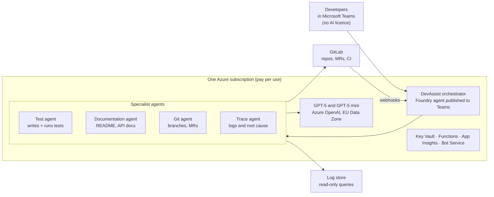

# Teams-based AI development agents on Microsoft Foundry

Nov 9, 2026 · Miranda

## Executive summary

**Recommendation:** build a set of AI development agents in **Microsoft Foundry**, powered by **GPT models from Azure OpenAI**, and publish them to **Microsoft Teams**. The company holds one Azure subscription. Developers use the agents from Teams with their existing Microsoft 365 accounts, at no cost to them and with no extra licence.

The agents generate and run unit tests, write technical documentation, work with GitLab repositories (branches, commits, merge requests, pipelines) and search application logs and traces. Tests run in the existing GitLab CI pipelines, so results are real, not guessed.

**Why this option:**

- **One subscription, zero seats.** Building and running Foundry agents has no licence fee. The company pays only for what the agents consume, on its Azure invoice.
- **Teams is the interface.** Publishing Foundry agents to Teams and Microsoft 365 Copilot has been generally available since June 2026. Users only need a standard Microsoft 365 account with Teams.
- **Full access to code and data.** Unlike low-code alternatives, a Foundry agent can call any API: GitLab, the monitoring system, internal services.
- **GPT, processed in the EU.** Azure OpenAI "Data Zone" deployments keep inference within the EU data zone.

**Expected cost:** about **$40 per month for a 5-developer pilot** and about **$155 per month for a 20-developer team**, roughly $8 per developer per month. Per-seat AI tools cost $19 to $30 per developer per month. Details are in the Pricing section.

## Solution at a glance

Developers talk to DevAssist in Teams. DevAssist hands each request to a specialist agent; all agents share the same GPT deployments and reach GitLab and the log store through scoped tools. GitLab webhooks can trigger the same agents automatically.

## The developer experience in Teams

Developers chat with one assistant, **DevAssist**, in Teams: in a one-to-one chat, or by @mentioning it in a team channel. DevAssist routes each request to the right specialist agent and replies in the same conversation with results and links to GitLab.

| A developer types in Teams | What happens behind the scenes | What they get back |
| --- | --- | --- |
| "Generate unit tests for `OrderService` in MR !231 of `payments-api`" | The test agent reads the MR diff, writes tests, commits them to a branch and triggers a GitLab CI pipeline to run them | "8 tests added, 8 passing. Coverage 41% → 78%." Links to the commit and the pipeline |
| "Document the public endpoints of `customer-portal` and open an MR" | The documentation agent reads the controllers, writes `docs/api.md` and updates the README, then opens an MR | A summary of the changes and a link to the MR for review |
| "Create a branch `feature/invoice-pdf` from `develop` and list open MRs assigned to me" | The Git agent calls the GitLab API | Confirmation with the branch link and a list of MRs with status |
| "Why did checkout fail yesterday between 17:00 and 18:00?" | The trace agent queries the log store, groups errors and checks recent deployments | Root-cause summary, error counts, sample log lines, and an offer to open a GitLab issue |
| "Why is pipeline #5512 red?" | The trace agent reads the failed job log through the GitLab API | The failing step, the probable cause and a suggested fix |

Agents never merge, deploy or delete. Any change to a repository lands on a branch or an MR that a person reviews.

## The agents

DevAssist is an orchestrator with four specialist agents. Each agent has its own instructions, its own GPT model and only the tools it needs. All instructions are versioned in a GitLab repository, so one owner manages them through merge requests.

| Agent | Inputs | Outputs | Tools | Suggested model |
| --- | --- | --- | --- | --- |
| **Test agent** | MR or branch, changed files, existing tests (for style), team testing rules, build command | Test files on an `ai/tests-*` branch, pipeline result (pass/fail), coverage before and after, bugs found while testing | GitLab API (read, branch, commit), pipeline trigger and job-log reader | GPT-5 (code-strong) |
| **Documentation agent** | Repository or folder, target audience, doc template | README updates, API reference (`docs/api.md`), changelog from merged MRs, code comments, all delivered as an MR | GitLab API (read, branch, commit, open MR) | GPT-5 |
| **Git agent** | Natural-language request, project name | Branches, MRs, MR comments, issues, pipeline status, all with links | GitLab API with a least-privilege service account | GPT-5 mini |
| **Trace agent** | Question, time range, service name; or a pasted stack trace; or a pipeline ID | Error groups with counts, probable root cause, matching log lines, code location, drafted GitLab issue | Read-only log query (Application Insights / Log Analytics or Elasticsearch), GitLab job logs | GPT-5 mini (GPT-5 for complex incidents) |

### How tests are actually run

The agent never runs code inside the chat. It follows a fixed loop:

1. Read the change and write tests that follow the project's existing style.
2. Commit them to a temporary branch and trigger the project's normal GitLab CI test job.
3. Read the job result. If a test is wrong, fix it and retry (up to 3 attempts). If the code is wrong, stop and report the bug.
4. Reply in Teams with the result and open an MR, or let the developer cherry-pick the tests.

Because tests run on the team's own runners, they use the real build, dependencies and test framework.

### How it can also work without being asked

The same agents can be triggered by GitLab webhooks. Typical automations: propose tests when an MR is opened, update the changelog when an MR is merged, and post a root-cause summary when a pipeline fails. Results appear as MR comments and, optionally, in a Teams channel.

## Licensing model

One Azure subscription covers everything. Nobody needs an AI licence to build, publish or use the agents.

| Who | What they need | Cost to them |
| --- | --- | --- |
| The company | One Azure subscription (pay-as-you-go), linked to the existing Microsoft 365 tenant | No fixed fee; usage only |
| Agent owner (builder) | Work account with access to the Foundry project (e.g. Azure AI User role on the resource group) | None |
| Microsoft 365 administrator | Approves the agent once in the Microsoft 365 admin center so it appears under "Built by your org" | None |
| Developers and other users | Their existing Microsoft 365 account with Teams | **None.** No Copilot, GitHub Copilot or Copilot Studio licence required |
| GitLab | One service account (bot user) with a token scoped to the relevant projects | Uses the existing GitLab subscription |

Two points to note:

- **Teams vs. Microsoft 365 Copilot Chat.** In Teams, a standard Microsoft 365 account is enough. Using the same agent inside Microsoft 365 Copilot Chat requires an eligible Microsoft 365 subscription; the Microsoft 365 Copilot add-on is optional.
- **Guests.** External guest accounts cannot call these agents. Users must be members of the same tenant.

## Pricing

A 20-developer team should spend about **$155 per month**, almost all of it on GPT tokens. All prices are US list prices for pay-as-you-go at the date of this document. Actual prices vary by region, agreement and currency.

### What the subscription pays for

| Service | What it does here | List price (USD) |
| --- | --- | --- |
| Azure subscription (pay-as-you-go) | Billing container for everything below | Free; no monthly fee or commitment |
| [Foundry Agent Service](https://azure.microsoft.com/pricing/details/foundry-agent-service/) | Runs the prompt-based agents and workflows | No additional charge for Foundry-native agents; you pay for model tokens and any paid tools |
| [GPT-5](https://www.azurespeed.com/AzureAiModelPricing/Models/openai-gpt-5), Data Zone Standard (EU) | Test, documentation and complex trace work | $1.375 per 1M input tokens; $11.00 per 1M output tokens |
| [GPT-5 mini](https://www.azurespeed.com/AzureAiModelPricing/Models/openai-gpt-5-mini), Data Zone Standard (EU) | Git operations, routine log questions, routing | $0.275 per 1M input tokens; $2.20 per 1M output tokens |
| [GPT-5.4](https://www.azurespeed.com/AzureAiModelPricing/Models/openai-gpt-5-4), Data Zone Standard (optional) | Upgrade path for harder tasks | $2.75–$3.00 per 1M input tokens; $16.50–$18.00 per 1M output tokens |
| [Azure AI Bot Service](https://azure.microsoft.com/pricing/details/bot-services/) | Connects the agent to Teams | Teams is a standard channel: unlimited messages, free |
| Azure Functions (consumption) | Small tool functions: GitLab calls, log queries | First 1M executions and 400,000 GB-s per month free |
| [Key Vault](https://azure.microsoft.com/pricing/details/key-vault/) | Stores the GitLab token and other secrets | $0.03 per 10,000 operations |
| [Application Insights / Log Analytics](https://monitoringcost.com/azure-application-insights-pricing) | Agent telemetry and audit trail | $2.30 per GB ingested after 5 GB free per month |
| GitLab CI | Runs the generated tests | Existing runners and subscription |

The built-in Code Interpreter tool is not needed, because tests run in GitLab CI.

### Monthly cost scenarios

| Scenario | Model tokens | Azure services | **Total per month** | Per developer | Per-seat alternative (GitHub Copilot Business, $19/seat) |
| --- | --- | --- | --- | --- | --- |
| Pilot, 5 developers | ~$35 | ~$5 | **~$40** | ~$8 | $95 |
| Team, 20 developers | ~$140 | ~$15 | **~$155** | ~$8 | $380 |
| Department, 60 developers | ~$420 | ~$25 | **~$445** | ~$7 | $1,140 |

**Assumptions for the 20-developer team** (our own estimate): per month, 200 test-generation requests with up to 3 fix attempts, 100 documentation requests, 300 automatic MR reviews, 300 trace questions and 1,000 Git operations. That is about 53M input and 9M output tokens. GPT-5 handles tests, documentation and reviews; GPT-5 mini handles Git operations and routine trace questions. Running everything on GPT-5 would cost about $175 per month in tokens; everything on GPT-5.4, about $300.

**Cost control:** set an Azure budget with alerts at 50%, 80% and 100%, cap tokens per request, and reject diffs above a maximum size.

## Security and governance

The agents propose; people decide. Nothing reaches a protected branch or production without human review.

- **Identity and access.** Only members of the company tenant can use the agents. Publication requires Microsoft 365 admin approval, and the admin can limit availability to specific groups.
- **Least privilege in GitLab.** One bot account with a token scoped to the pilot projects. It can read code, create branches and MRs, comment and trigger pipelines. It cannot merge, push to protected branches or delete.
- **Read-only logs.** The trace agent has query-only access to the log store.
- **Secrets.** GitLab tokens and API keys live in Azure Key Vault and are read through managed identities, never in code or prompts.
- **EU data processing.** GPT models are deployed with the Data Zone (EU) option. Teams and Microsoft 365 data stay under the tenant's existing compliance, retention and audit policies.
- **Personal data in logs.** Mask emails, IDs, phone numbers and IP addresses before log lines reach the model. Validate the approach with the data protection officer.
- **Audit trail.** Every request, tool call, token count and cost is logged to Application Insights.
- **Change control for agents.** Agent instructions and tool definitions are code in GitLab, changed only through reviewed MRs, with a test set of sample requests run before each release.

## Implementation plan

A working pilot in Teams is realistic in about six weeks, starting with the Git and test agents.

1. **Weeks 1–2: Foundation.** Create the Azure subscription and budget alerts, a Foundry project in an EU region, and GPT-5 and GPT-5 mini Data Zone deployments. Set up Key Vault, Application Insights and the GitLab bot account.
2. **Weeks 3–4: First agents.** Build the Git agent and the test agent with their GitLab tools. Publish DevAssist to Teams for a pilot group of 5 developers on one project.
3. **Weeks 5–6: Measure and extend.** Add the documentation and trace agents. Track cost per request, accepted vs. rejected tests and user feedback.
4. **After the pilot: Roll-out.** Request organisation-wide approval in the Microsoft 365 admin center, enable GitLab webhooks for automatic runs, and onboard more projects.

### Prerequisites

- [ ] Azure subscription (pay-as-you-go) linked to the company's Microsoft 365 tenant
- [ ] A resource group and Foundry project in an EU region, with the agent owner granted access
- [ ] Monthly budget for the pilot (suggested: $100 with alerts)
- [ ] Microsoft 365 administrator available to approve the Teams publication
- [ ] GitLab bot account and a token scoped to the pilot project
- [ ] Network access from Azure to GitLab (and to self-managed runners, if any)
- [ ] Read-only access to the log store for the trace agent
- [ ] Data protection sign-off on sending code and masked logs to the model

## Sources

- [Foundry Agent Service pricing](https://azure.microsoft.com/pricing/details/foundry-agent-service/) — Microsoft Azure
- [Publish agents to Microsoft 365 Copilot and Microsoft Teams](https://learn.microsoft.com/azure/foundry/agents/how-to/publish-copilot) — Microsoft Learn
- [What's new in Microsoft Foundry, June 2026 (Teams publishing GA)](https://devblogs.microsoft.com/foundry/whats-new-in-microsoft-foundry-june-2026/) — Microsoft Foundry Blog
- [Publish to Teams and Microsoft 365 Copilot: licensing and costs](https://azure.github.io/AI-Landing-Zones/agent-landing-zone/publish-to-teams/) — Azure AI Landing Zones
- [Azure OpenAI pricing](https://azure.microsoft.com/pricing/details/azure-openai) — Microsoft Azure
- [GPT-5](https://www.azurespeed.com/AzureAiModelPricing/Models/openai-gpt-5), [GPT-5 mini](https://www.azurespeed.com/AzureAiModelPricing/Models/openai-gpt-5-mini) and [GPT-5.4](https://www.azurespeed.com/AzureAiModelPricing/Models/openai-gpt-5-4) Azure pricing by deployment type — AzureSpeed (Azure Retail Prices API data)
- [Azure AI Bot Service pricing](https://azure.microsoft.com/pricing/details/bot-services/) — Microsoft Azure
- [Key Vault pricing](https://azure.microsoft.com/pricing/details/key-vault/) — Microsoft Azure
- [Application Insights pricing 2026](https://monitoringcost.com/azure-application-insights-pricing) — MonitoringCost
- [GitHub Copilot Business pricing](https://docs.github.com/en/copilot/get-started/plans) — GitHub Docs (per-seat comparison)
