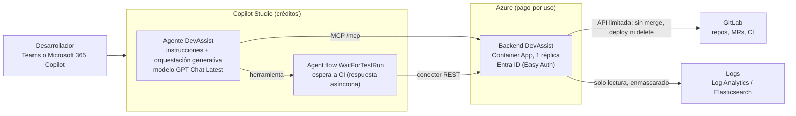

# Alternativa: DevAssist como agente de Microsoft Copilot Studio

Rama `alt/copilot-studio`. Compara con la guía [Teams-AI-Agents-Microsoft-Foundry.md](../Teams-AI-Agents-Microsoft-Foundry.md)
y con su implementación ([DEVASSIST.md](DEVASSIST.md)). Precios y capacidades consultados en Microsoft Learn el **10 de noviembre de 2026**.

## Índice

- [Qué es](#qué-es)
- [Qué cubre de la guía](#qué-cubre-de-la-guía)
- [Suscripciones y licencias necesarias](#suscripciones-y-licencias-necesarias)
- [Coste estimado para 5 y 20 desarrolladores](#coste-estimado-para-5-y-20-desarrolladores)
- [Pros](#pros)
- [Contras](#contras)
- [Despliegue paso a paso](#despliegue-paso-a-paso)
- [Qué está verificado aquí y qué no](#qué-está-verificado-aquí-y-qué-no)
- [Mapa de ficheros](#mapa-de-ficheros)

## Qué es

DevAssist pasa a ser **un agente de Copilot Studio con orquestación generativa**, publicado en Teams y en
Microsoft 365 Copilot desde el propio Copilot Studio. Copilot Studio pone el modelo (por defecto *GPT Chat
Latest*), la conversación, la autenticación de los usuarios y los canales. No hacen falta Azure OpenAI, Bot
Service ni un servicio de bot propio.

Lo que no puede hacer un agente low-code (bloquear merges en código, enmascarar datos personales, medir los
resultados de CI) sigue en código: un **backend pequeño** (`src/devassist_copilot/`) que reutiliza el cliente
de GitLab con lista blanca, el enmascarado, el almacén de logs y la auditoría de `src/devassist`. El agente lo
llama de dos formas, generadas desde el mismo registro de herramientas:

- **Servidor MCP** (Streamable HTTP, `/mcp`): las 18 herramientas del agente. Copilot Studio solo admite este
  transporte desde agosto de 2025 y exige orquestación generativa.
- **API REST con OpenAPI 2.0** (`/api/tools/<Herramienta>`), para un *custom connector* de Power Platform. La
  usa el *agent flow* `WaitForTestRun`, porque los flujos no pueden llamar a MCP.



### Cómo se reparten los cuatro especialistas

En Copilot Studio no hay cuatro agentes con modelos distintos: hay **un agente** cuyas instrucciones
(`copilot-studio/agent/instructions.md`, 4.074 caracteres de un máximo de 8.000) describen cada especialista,
y el orquestador elige la herramienta. Un *topic* clásico (`Help`) responde a "ayuda" con texto fijo, que
cuesta 1 crédito en lugar de 2.

| Especialista | Herramientas (MCP) | Qué pone el modelo | Qué mide el código |
| --- | --- | --- | --- |
| Tests | `StartTestSession`, `SubmitTestFile`, `GetTestRun`, `OpenTestMergeRequest`, `ReportCodeBug` + flujo `WaitForTestRun` | El fichero de test y la decisión "falla el test o el código" | Rama `ai/tests-*`, ruta permitida, intentos, resultado del pipeline, recuentos, cobertura, la frase del resumen |
| Documentación | `GetDocsSources`, `OpenApiReferenceMergeRequest`, `OpenCodeCommentsMergeRequest`, `OpenChangelogMergeRequest` | `docs/api.md` y los docstrings | Enlace en el README, comparación del árbol sintáctico (rechaza cambios de código), changelog solo desde MRs fusionadas |
| Git | `ListMergeRequests`, `CreateBranch`, `GetPipelineStatus`, `CommentOnMergeRequest`, `CreateIssue`, `ListProjects` | Interpretar la petición | Todo lo demás; textos publicados en GitLab enmascarados y firmados "on behalf of" |
| Trazas | `InvestigateIncident`, `GetFailedPipelineLog`, `CreateIssue` | El diagnóstico | Rango de tiempo, consulta de logs, agrupado y recuento de errores, despliegues cercanos, enmascarado |

### Cómo funciona el bucle de tests (minutos, sin fiarse del modelo)

En la versión Foundry un proceso ejecuta el bucle entero. Aquí el modelo de Copilot Studio escribe los tests
en varias llamadas, así que el backend guarda una **sesión** por petición y hace cumplir las reglas entre
llamadas:

1. `StartTestSession` lee la MR (rechaza diffs por encima del límite antes de hacer nada), crea
   `ai/tests-<nombre>-<id>` y devuelve diff, código, un test de ejemplo y las reglas del equipo.
2. El modelo escribe un fichero y llama a `SubmitTestFile`. El backend solo acepta rutas de test (nunca
   `.gitlab-ci.yml` ni código), no sobrescribe un test escrito por una persona (`*_ai.py`), solo edita ese
   fichero, hace commit en la rama `ai/` y lanza el pipeline. Responde al momento.
3. El agente llama al **agent flow `WaitForTestRun`**, que repite `GetTestRun` (cada llamada espera hasta
   25 s en el backend) hasta que el pipeline termina, con tope de 40 minutos. Con la **respuesta asíncrona**
   activada, el flujo puede durar más de 2 minutos y devuelve el resultado al agente cuando acaba. En Teams
   esa devolución está soportada; en Microsoft 365 Copilot no, y ahí el usuario pregunta "¿cómo van mis
   tests?" y el agente llama a `GetTestRun`.
4. Si CI falla, `GetTestRun` devuelve el log enmascarado. El modelo corrige y vuelve al paso 2 (máximo 3
   intentos, contados por el backend) o llama a `ReportCodeBug`, que solo se acepta después de un pipeline rojo.
5. `OpenTestMergeRequest` solo abre la MR si el último pipeline pasó, y redacta el resumen con los datos de CI:
   `4 tests added. Pipeline: 6 passing, 0 failing. Coverage 38% → 100%.` Las instrucciones piden mostrarlo tal cual.

## Qué cubre de la guía

| Punto de la guía | Estado | Motivo |
| --- | --- | --- |
| Agente de tests | 🟡 Parcial | Escribe, hace commit en `ai/tests-*`, lanza CI, corrige hasta 3 veces y abre MR, con todas las reglas en el backend (probado con CI real). Pero el orden de los pasos lo decide el modelo de orquestación en lugar de un bucle en código, el modelo es *GPT Chat Latest* (no GPT-5 con razonamiento para decidir "test o código") y la espera asíncrona solo devuelve el resultado en Teams. |
| Agente de documentación | ✅ Cubierto | `docs/api.md` + README, comentarios en código con comprobación del árbol sintáctico, changelog desde MRs fusionadas. Todo entregado como MR. |
| Agente Git | ✅ Cubierto | Ramas, MRs (también "asignadas a mí" con la identidad de Entra ID), comentarios, issues y estado de pipelines, con enlaces que salen de GitLab. |
| Agente de trazas | 🟡 Parcial | Logs por rango de tiempo, pipelines rojos y borrador de issue igual que en Foundry (mismo código de logs y enmascarado). Un stack trace **pegado en el chat** llega al modelo de Copilot Studio sin enmascarar, porque no pasa por el backend. |
| Interfaz Teams | ✅ Cubierto | Canal nativo de Copilot Studio: chat 1:1 y @mención en canales, aprobación en "Built for your org". Sin Bot Service ni paquete de app propio. |
| Microsoft 365 Copilot | 🟡 Parcial | Se publica marcando "Make agent available in Microsoft Copilot". Allí no funciona la devolución de los flujos asíncronos, Copilot puede quitar URLs incrustadas y no hay reacciones de feedback. |
| Webhooks / automatizaciones | ❌ No | No implementado. El camino sería un *agent flow* con disparador HTTP o un desencadenador de evento que invoque al agente de forma autónoma; esas ejecuciones siempre consumen créditos, aunque los usuarios tengan Microsoft 365 Copilot. Los webhooks de `devassist serve` siguen existiendo, pero usan el modelo de Foundry. |
| Garantías de seguridad | ✅ Cubierto | Nunca merge/deploy/delete (cliente con lista blanca reutilizado), commits solo en `ai/*`, lista blanca de proyectos (obligatoria al exponer el servicio), enmascarado de logs y de lo que se publica en GitLab, solo usuarios del tenant ("Authenticate with Microsoft" + Easy Auth). Lo que no se puede reproducir es el filtrado de URLs inventadas de la versión Foundry: aquí el modelo escribe la respuesta final y solo las instrucciones lo impiden. |
| Datos en la UE | 🟡 Parcial | Entorno de Power Platform en Europa y *GPT Chat Latest* procesado en la región (la tabla de modelos lo marca "Default", no "cross-geo"). Los modelos de razonamiento (GPT-5 Reasoning en preview, Claude) son preview o "cross-geo" en Europa, y Microsoft avisa de que el canal de Teams puede sacar datos del límite de cumplimiento de Copilot Studio. Backend y logs en una región de Azure de la UE. |
| Auditoría / coste | 🟡 Parcial | El backend audita cada llamada (herramienta, usuario, resultado, duración) y `devassist-copilot usage` estima los créditos. Los tokens y créditos reales solo se ven en Copilot Studio y en el centro de administración de Power Platform. Hay límites mensuales por agente y, con pago por uso, presupuesto de Azure con alertas. Las instrucciones y definiciones viven en Git (`copilot-studio/agent`) y se sincronizan con la extensión de VS Code; la batería de pruebas de release no se ha portado a Copilot Studio. |

## Suscripciones y licencias necesarias

Precios de lista en USD, consultados el 10/11/2026. Varían por país, moneda y contrato.

| Concepto | Precio oficial | Fuente |
| --- | --- | --- |
| Copilot Studio, pago por uso | **0,01 $ por crédito**, facturado en la suscripción de Azure (política de facturación en el centro de administración de Power Platform) | [Pay-as-you-go meters](https://learn.microsoft.com/power-platform/admin/pay-as-you-go-meters) (Learn, 14/10/2026) |
| Copilot Studio, paquete de capacidad | **200 $ por paquete y mes, 25.000 créditos**, para todo el tenant. Lo que no se usa no pasa al mes siguiente. Con más de un 125 % de consumo sin pago por uso, los agentes se bloquean | [Copilot Studio pricing](https://www.microsoft.com/en-us/microsoft-365-copilot/pricing/copilot-studio), [Billing rates](https://learn.microsoft.com/microsoft-copilot-studio/requirements-messages-management) |
| Plan de prepago (Copilot Credit Commit Units) | Hasta un 20 % de ahorro por pago anticipado de un año | [Copilot Studio pricing](https://www.microsoft.com/en-us/microsoft-365-copilot/pricing/copilot-studio), [Licensing](https://learn.microsoft.com/microsoft-copilot-studio/billing-licensing) |
| Tarifas en créditos | Respuesta clásica 1 · respuesta generativa 2 · **acción del agente 5** (cada herramienta, topic o disparador) · *grounding* en Graph 10 · **acciones de agent flow 13 por cada 100** · modelo de razonamiento +10 por cada 1.000 tokens | [Billing rates](https://learn.microsoft.com/microsoft-copilot-studio/requirements-messages-management) (Learn, 30/10/2026) |
| Microsoft 365 Copilot (opcional) | **30 $ por usuario y mes**, pago anual. Con ella, el uso interactivo del agente en Teams, Copilot y SharePoint no cobra créditos (uso justo), incluidos los agent flows llamados por el agente. No cubre ejecuciones autónomas | [Copilot Studio pricing](https://www.microsoft.com/en-us/microsoft-365-copilot/pricing/copilot-studio), [Billing rates](https://learn.microsoft.com/microsoft-copilot-studio/requirements-messages-management) |
| Dataverse del entorno | En entornos de pago por uso, 1 GB de base de datos y 1 GB de ficheros incluidos; después, 48 $/GB/mes y 2,40 $/GB/mes. Las transcripciones de conversación se guardan ahí | [Pay-as-you-go meters](https://learn.microsoft.com/power-platform/admin/pay-as-you-go-meters) |
| Backend en Azure | Container App, Key Vault y Application Insights: unos 5–15 $/mes, la misma estimación de servicios de la guía (aquí sin Bot Service ni Azure OpenAI) | [Guía Foundry](../Teams-AI-Agents-Microsoft-Foundry.md#pricing) |

| Quién | Qué necesita | Coste para esa persona |
| --- | --- | --- |
| La empresa | Una suscripción de Azure (pago por uso de Copilot Studio y backend) o un paquete de capacidad, y un entorno de Power Platform en Europa con Dataverse | Solo el uso |
| Creadores del agente (1–2) | Con paquete: licencia de usuario de Copilot Studio (gratis, pero exige tener el paquete). Solo con pago por uso: el grupo de seguridad de "Copilot Studio authors" en el centro de administración de Power Platform. La licencia de prueba **no permite publicar**. Según Learn, la licencia de Microsoft 365 Copilot permite crear agentes del *harness* de GitHub Copilot; para el *harness* estándar que se usa aquí, usa una de las dos opciones anteriores | 0 $ |
| Desarrolladores | Su cuenta de Microsoft 365 con Teams y acceso a Microsoft Copilot (Copilot Chat). **Sin Microsoft 365 Copilot pueden usarlo**: su uso consume créditos de la empresa. Con Microsoft 365 Copilot, el uso interactivo no consume | 0 $ (o 30 $/mes si se les compra Microsoft 365 Copilot) |
| Administrador de Microsoft 365 / Teams | Permitir las apps de Power Platform en Teams y aprobar el agente en "Built for your org" | 0 $ |
| Administrador de Power Platform | Política de facturación, límites mensuales por agente, políticas de datos (DLP) que permitan los dos conectores | 0 $ |
| GitLab | Una cuenta bot con token limitado a los proyectos del piloto | Suscripción existente |

Los *agent flows* no necesitan licencia de Power Automate: se pagan en créditos (las ejecuciones de prueba no cuentan).

## Coste estimado para 5 y 20 desarrolladores

Calculado por `src/devassist_copilot/costing.py` (`devassist-copilot estimate`), fijado en un test.

**Supuestos** (estimación propia, no medida):

- Carga mensual de la guía para 20 desarrolladores, a escala lineal: 200 peticiones de tests (1,5 ejecuciones
  de CI de media), 100 de documentación, 300 revisiones automáticas de MR, 300 preguntas de trazas y 1.000
  operaciones Git.
- Modelo *GPT Chat Latest* (sin razonamiento): no hay cargo por tokens, solo por evento.
- Créditos por petición: cada respuesta del agente cuenta como respuesta generativa (2) y cada llamada a
  herramienta como acción del agente (5). El flujo de espera ejecuta unas 24 acciones por ejecución de CI.

| Petición | Cálculo | Créditos |
| --- | --- | --- |
| Tests | 2 + 5 (`Start`) + 5 (`OpenTestMergeRequest`) + 1,5 × (5 `Submit` + 5 llamada al flujo + 24 acciones × 0,13) | 31,7 |
| Documentación | 2 + 5 + 5 | 12 |
| Revisión automática de MR | lo de tests + 5 del disparador (autónoma) | 36,7 |
| Trazas | 2 + 5 + 30 % de las veces `CreateIssue` | 8,5 |
| Operación Git | 2 + 5 | 7 |

| Escenario | Créditos/mes | Copilot Studio | Backend Azure | **Total/mes** | Por desarrollador |
| --- | --- | --- | --- | --- | --- |
| Piloto, 5 desarrolladores | 7.022 | 70,22 $ (pago por uso; el paquete de 200 $ no compensa) | ~5 $ | **~75 $** | ~15 $ |
| Equipo, 20 desarrolladores | 28.090 | 230,90 $ (1 paquete + 3.090 créditos a 0,01 $); 280,90 $ solo pago por uso | ~15 $ | **~246 $** | ~12 $ |
| Equipo de 20 que **ya tiene** Microsoft 365 Copilot | 11.004 (solo las revisiones automáticas) | 110,04 $ | ~15 $ | **~125 $** | ~6 $ |

Para comparar: la guía estima ~40 $ y ~155 $ con Foundry. Comprar Microsoft 365 Copilot solo para esto
(20 × 30 $ = 600 $/mes) no compensa.

**Cuidado con los modelos de razonamiento.** Si el agente se orquesta con un modelo "deep" (GPT-5 Reasoning,
Claude Opus), se suman 10 créditos por cada 1.000 tokens facturados. Con los ~62 millones de tokens al mes
que la guía estima para 20 desarrolladores serían **unos 6.200 $ más al mes** (menos lo que salga de la caché
de prompts). Por eso se fija *GPT Chat Latest*.

Sin revisiones automáticas (lo que esta rama implementa), el equipo de 20 baja a 17.086 créditos: ~171 $ con
pago por uso.

## Pros

- **Nada de infraestructura de bot**: sin Bot Service, sin manifiesto de Teams, sin servidor de mensajes ni
  gestión de tokens de Teams. Publicar en Teams y en Copilot es marcar un canal y pedir aprobación.
- **Sin despliegues de modelos**: no hay que crear Azure OpenAI, elegir región ni gestionar cuotas. El modelo
  por defecto se actualiza solo (con 30 días de aviso para cambios de versión mayor).
- **Gratis para quien ya tiene Microsoft 365 Copilot**: el uso interactivo no consume créditos.
- **Gobierno de Power Platform**: entornos, DLP sobre los conectores (también regulan el MCP), límites
  mensuales por agente, analítica de conversaciones y transcripciones sin programar nada.
- **El código que importa se conserva**: las garantías de seguridad y el bucle de CI son el mismo código
  probado de `src/devassist`. Las herramientas se describen una vez y salen como MCP y como OpenAPI.
- **Ajustes por personas no programadoras**: instrucciones, topics y flujos se cambian desde el portal (o
  desde Git con la extensión de VS Code).

## Contras

- **Más caro que Foundry** a este volumen (~246 $ frente a ~155 $ para 20 desarrolladores) y menos
  predecible: se paga por evento y por llamada a herramienta, no por token, y el mismo trabajo cuesta según
  cuántas herramientas encadene el modelo.
- **Se sigue necesitando un backend propio** (MCP/REST, Entra ID, Key Vault): el low-code no evita escribir
  ni operar código para GitLab, el enmascarado y las garantías.
- **El modelo de razonamiento sale carísimo** (10 créditos por 1.000 tokens) y, en Europa, en preview o
  fuera de la región. La decisión "falla el test o el código" la toma un modelo de chat general.
- **El bucle de tests depende del orquestador**: las reglas están en el backend, pero el orden de los pasos
  lo decide el modelo. Las respuestas finales las escribe el modelo, así que no se pueden filtrar URLs
  inventadas como en la versión Foundry.
- **Asincronía limitada**: el flujo que espera a CI solo devuelve el resultado en Teams; en Microsoft 365
  Copilot hay que preguntar. Exige un entorno en la "nueva infraestructura" de Power Automate.
- **Automatizaciones de GitLab más caras y sin hacer**: las ejecuciones autónomas siempre pagan créditos.
- **Dependencia de la plataforma**: formato de los ficheros del agente, nombres de modelos y tarifas cambian
  a menudo (el cambio de "mensajes" a "créditos" fue en septiembre de 2025; varios modelos se retiran en
  noviembre de 2026). Se necesita Dataverse.
- **Probarlo de verdad exige pagar o tener tenant**: la licencia de prueba no deja publicar.

## Despliegue paso a paso

Requisitos: lo de la guía (tenant, suscripción de Azure, administrador de Microsoft 365, cuenta bot de
GitLab, visto bueno de protección de datos), más un administrador de Power Platform, la
[CLI de Power Platform](https://learn.microsoft.com/power-platform/developer/cli/introduction) (`pac`) y
Azure CLI.

### 1. Probar en local (gratis)

```bash
python -m venv .venv
```

```bash
.venv\Scripts\pip install -e ".[dev]"
```

```bash
.venv\Scripts\devassist fake-gitlab --port 8931
```

En otra terminal (PowerShell):

```powershell
$env:GITLAB_URL="http://127.0.0.1:8931"; $env:GITLAB_PROJECTS="acme/payments-api,acme/customer-portal"; .venv\Scripts\devassist-copilot serve --port 3981
```

```bash
.venv\Scripts\devassist-copilot call InvestigateIncident "{\"question\": \"Why did checkout fail yesterday between 17:00 and 18:00?\"}"
```

Cualquier cliente MCP (por ejemplo MCP Inspector) puede conectarse a `http://127.0.0.1:3981/mcp`.

### 2. Entorno y facturación de Power Platform

1. Crea un entorno de producción en la región **Europa** con Dataverse.
2. Elige cómo pagar: una política de facturación de pago por uso enlazada a la suscripción de Azure que
   incluya Copilot Studio, o un paquete de capacidad asignado al entorno.
3. Configura un límite mensual de créditos para el agente (Licensing → Copilot Studio → Manage agents) y un
   presupuesto de Azure con avisos al 50/80/100 %.
4. Comprueba que el entorno está en la nueva infraestructura de Power Automate (necesario para la respuesta
   asíncrona de los flujos).
5. Da acceso a los creadores: licencia de usuario de Copilot Studio (con paquete) o el grupo de "Copilot Studio authors".

### 3. Backend en Azure

Reutiliza la imagen de DevAssist cambiando el comando. Con `infra/main.bicep` ya tienes Key Vault, registro e
identidad; luego:

```bash
az acr build --registry <registro> --image devassist:1.0.0 --file Dockerfile.devassist .
```

```bash
az containerapp create --name devassist-copilot --resource-group rg-devassist --environment <entorno de Container Apps> --image <registro>.azurecr.io/devassist:1.0.0 --registry-server <registro>.azurecr.io --registry-identity <id de la identidad> --user-assigned <id de la identidad> --command devassist-copilot --args serve --target-port 3981 --ingress external --min-replicas 1 --max-replicas 1 --secrets gitlab-token=keyvaultref:<uri del secreto gitlab-token>,identityref:<id de la identidad> --env-vars DEVASSIST_COPILOT_HOST=0.0.0.0 DEVASSIST_COPILOT_PORT=3981 DEVASSIST_COPILOT_AUTH=easyauth GITLAB_URL=https://gitlab.tuempresa.com GITLAB_PROJECTS=grupo/payments-api DEVASSIST_LOG_STORE=azure LOG_ANALYTICS_WORKSPACE_ID=<id> GITLAB_TOKEN=secretref:gitlab-token
```

Una sola réplica, porque las sesiones de test viven en un fichero local. Activa la autenticación integrada
con Entra ID para que solo pasen tokens válidos del tenant:

```bash
az containerapp auth microsoft update --name devassist-copilot --resource-group rg-devassist --client-id <app de Entra ID> --client-secret <secreto> --tenant-id <tenant> --yes
```

```bash
az containerapp auth update --name devassist-copilot --resource-group rg-devassist --unauthenticated-client-action Return401
```

Para un piloto rápido sirve `DEVASSIST_COPILOT_AUTH=apikey` con `DEVASSIST_COPILOT_API_KEY` (24+ caracteres)
desde Key Vault. En ese modo la identidad del usuario la declara el agente en la cabecera
`X-DevAssist-Requester`.

### 4. Conectores

Genera las definiciones con el host real:

```bash
.venv\Scripts\devassist-copilot export-connector --host devassist-copilot.<region>.azurecontainerapps.io
```

Conector REST (para el flujo):

```bash
pac connector create --environment <id del entorno> --api-definition-file copilot-studio/connector/rest/apiDefinition.swagger.json --api-properties-file copilot-studio/connector/rest/apiProperties.json
```

Servidor MCP: en Copilot Studio, **Tools → Add a tool → New tool → Model Context Protocol**. URL
`https://<host>/mcp`. Autenticación **OAuth 2.0 → Manual** con la app de Entra ID (autorización
`https://login.microsoftonline.com/<tenant>/oauth2/v2.0/authorize`, token `.../token`, ámbito
`api://<client-id>/.default`) o, en el piloto, **API key** en la cabecera `X-API-Key`. Como alternativa al
asistente, importa `copilot-studio/connector/mcp/apiDefinition.swagger.json` como custom connector. Permite
ambos conectores en la política DLP del entorno.

### 5. Agente

1. Crea el agente **DevAssist** y activa la orquestación generativa.
2. Pega `copilot-studio/agent/instructions.md` en las instrucciones, o clona el agente con la extensión de
   Copilot Studio para VS Code, copia encima `copilot-studio/agent/` y aplica los cambios (compara antes: los
   `.mcs.yml` de esta rama están escritos a mano con la estructura de la extensión).
3. Modelo: **GPT Chat Latest**. Sin conocimiento general ni búsqueda web. Autenticación "Authenticate with Microsoft".
4. Añade la herramienta MCP y marca la confirmación del usuario en `CreateBranch`, `CommentOnMergeRequest` y `CreateIssue`.
5. Crea el agent flow **WaitForTestRun** con el disparador "When an agent calls the flow" (entrada
   `sessionId`), un bucle *Do until* sobre `GetTestRun` del conector REST con `waitSeconds` 25 y tope de 40
   minutos, y "Respond to the agent" con `status` y `result`. La definición está en
   `copilot-studio/agent/workflows/WaitForTestRun/workflow.json`. En los ajustes de "Respond to the agent",
   activa **Asynchronous response**. Añade el flujo como herramienta del agente.
6. Añade el topic `Help` (`copilot-studio/agent/topics/Help.mcs.yml`).
7. Prueba en el panel de pruebas con las frases de inicio del agente.

### 6. Publicar en Teams y Microsoft 365 Copilot

1. **Publish**, luego **Channels → Microsoft 365 and Microsoft Teams**, con "Make agent available in Microsoft Copilot".
2. Compártelo con el grupo del piloto (Availability options → Show to my teammates and shared users).
3. Para toda la empresa: **Show to everyone in my org → Submit to org catalog**; el administrador lo aprueba
   en el centro de administración de Teams y aparece en "Built for your org".

### 7. GitLab

Cuenta bot con rol Developer solo en los proyectos del piloto y ramas protegidas con "Allowed to merge:
Maintainers", como en la guía.

## Qué está verificado aquí y qué no

**Verificado en esta máquina, gratis:**

- `python -m pytest`: **127 tests en verde** (97 de antes + 30 nuevos en `tests/test_copilot_studio.py`).
  Los nuevos cubren, contra el GitLab de pruebas cuya CI ejecuta pytest de verdad:
  - el bucle de tests completo por REST y por MCP, con el resultado `4 tests added. Pipeline: 6 passing, 0 failing. Coverage 38% → 100%.`;
  - un test erróneo que CI rechaza y luego se corrige; el bug real de la MR !232 parado sin MR; el agotamiento de intentos;
  - los límites de la sesión: solo rutas de test, sin sobrescribir tests de personas, un solo fichero, sesiones del usuario que las creó, diffs grandes rechazados;
  - las garantías: proyectos fuera de la lista blanca, ninguna herramienta para merge/deploy/delete, textos enmascarados en GitLab, evidencias de logs contadas en código y enmascaradas, docs que rechazan cambios de código;
  - el protocolo MCP (initialize, notificaciones, tools/list, tools/call, errores, 405 en GET, bloqueo de Origin);
  - la autenticación por API key y por Easy Auth, y el rechazo de configuraciones inseguras al arrancar;
  - que las dos definiciones OpenAPI son **Swagger 2.0 válido** (`openapi-spec-validator`), sin `oneOf`/`$ref`, y que los ficheros guardados coinciden con lo generado;
  - que los YAML del agente se leen, que las instrucciones coinciden y caben en 8.000 caracteres, y que el flujo solo llama a operaciones de lectura que existen;
  - las cifras de coste.
- **En vivo** con el GitLab de pruebas en el puerto 8931 y el backend en el 3981: 401 sin clave, `initialize`,
  `tools/list` con las 18 herramientas y llamadas por MCP y REST con `curl`.
- **Con un cliente MCP real y un modelo real**: Agent Framework (`MCPStreamableHTTPTool`, librería `mcp`
  2.3.0) con qwen3:8b en Ollama y las mismas instrucciones del agente. A "Why is pipeline #5512 of
  payments-api red?" llamó a `GetFailedPipelineLog`, dio la causa (`ModuleNotFoundError: app.settings`), una
  línea "Suggested fix" y ofreció abrir un issue (71 s).

**No verificado:**

- **Nada se ha probado en Copilot Studio real** (requiere tenant y pago; la prueba gratuita no publica): ni la
  importación de los conectores, ni el asistente MCP, ni la orquestación con *GPT Chat Latest*, ni el agent
  flow, ni la respuesta asíncrona, ni Teams o Microsoft 365 Copilot, ni el consumo real de créditos.
- Los ficheros `.mcs.yml` y `workflow.json` están **escritos a mano** con la estructura que documenta
  Microsoft para la extensión de VS Code y los flujos; su esquema exacto no se ha contrastado con un clon real.
- El bucle de tests completo con un modelo real **no terminó**: con qwen3:8b el agente local llamó a
  `StartTestSession` y no acabó en 9 minutos. El Ollama compartido tiene un contexto de 4.096 tokens, que no
  da para el código de la sesión más las herramientas. El bucle sí está probado con ficheros de test fijos.
- La autenticación con Easy Auth está simulada con la cabecera que inyecta la plataforma; no se ha desplegado
  ninguna Container App.
- El servidor MCP negocia la versión 2025-06-18 del protocolo. La librería cliente ya anuncia una revisión
  de 2026; no se ha comprobado qué versión usa Copilot Studio.
- El coste es una estimación con supuestos propios: mide un mes de piloto con `devassist-copilot usage` y
  los informes del centro de administración de Power Platform.

## Mapa de ficheros

```
src/devassist_copilot/
  tools.py        las 18 herramientas, sus esquemas y las reglas (sesiones de test, enmascarado, identidad)
  sessions.py     estado del bucle de tests, persistido en un fichero
  mcp.py          servidor MCP (JSON-RPC sobre Streamable HTTP)
  server.py       HTTP: /mcp, /api/tools/<Herramienta>, /openapi.json, autenticación
  openapi.py      Swagger 2.0 para los custom connectors (REST y MCP)
  costing.py      tarifas oficiales y estimación de créditos
  cli.py          devassist-copilot serve | call | export-connector | estimate | usage
copilot-studio/
  agent/          instrucciones, agent.mcs.yml, settings, herramienta MCP, flujo como herramienta, topic Help,
                  connection references y el agent flow WaitForTestRun (workflow.json)
  connector/      rest/ y mcp/: apiDefinition.swagger.json + apiProperties.json (generados)
tests/test_copilot_studio.py
```
