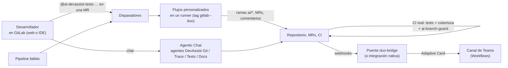

# Alternativa: GitLab Duo (Duo Agent Platform) + avisos en Teams

Alternativa a la guía [Teams-AI-Agents-Microsoft-Foundry.md](../Teams-AI-Agents-Microsoft-Foundry.md):
en lugar de construir los agentes en Microsoft Foundry, usar la IA que ya trae GitLab, la plataforma
que la empresa ya utiliza, y llevar sus resultados a Microsoft Teams.

Todos los precios y datos de este documento se consultaron el **10 de noviembre de 2026** en
docs.gitlab.com y about.gitlab.com. Son precios de lista en dólares y pueden cambiar.

## Índice

- [Qué es](#qué-es)
- [Qué cubre de la guía](#qué-cubre-de-la-guía)
- [Suscripciones y licencias](#suscripciones-y-licencias)
- [Coste estimado para 5 y 20 desarrolladores](#coste-estimado-para-5-y-20-desarrolladores)
- [Pros](#pros)
- [Contras](#contras)
- [Despliegue paso a paso](#despliegue-paso-a-paso)
- [Qué está verificado aquí y qué no](#qué-está-verificado-aquí-y-qué-no)
- [Fuentes](#fuentes)

## Qué es

**GitLab Duo Agent Platform** es la capa de agentes de IA de GitLab. Está disponible de forma general
desde GitLab 18.8 en GitLab.com, Self-Managed y Dedicated, para los planes Premium y Ultimate. En
GitLab.com también funciona en el plan Free pagando créditos. Sus piezas:

- **Agentic Chat**: un chat dentro de GitLab (barra lateral de issues y MRs) y en los IDE (VS Code,
  JetBrains, Visual Studio) y la CLI de Duo. Puede leer y escribir en GitLab con herramientas.
- **Agentes**: los *foundational* que trae GitLab (Planner, CI Expert, Security Analyst…), los
  **personalizados** (nombre, prompt de sistema y lista de herramientas, creados en la interfaz) y los externos.
- **Flujos**: varios agentes que trabajan en segundo plano en un runner de CI. Los hay *foundational*
  (Code Review, Fix CI/CD Pipeline, Developer…) y **personalizados**, que se escriben en YAML
  (*flow registry v1*). Los personalizados son GA desde GitLab 19.2.
- **Disparadores** (*triggers*): lanzan un flujo cuando una persona menciona o asigna su cuenta de
  servicio, la pone de revisora de una MR, o cuando cambia un pipeline (pasa, falla…), una MR o un work item.
- **AI Catalog**: donde se publican y comparten agentes y flujos (privados, restringidos al grupo o públicos).
- **MCP**: GitLab ofrece un servidor MCP para herramientas externas, y Duo puede usar servidores MCP
  externos (en el IDE y la CLI, y en beta para agentes personalizados).
- **Modelos**: los elige GitLab (por defecto Claude Sonnet 5.5) o el propietario del grupo por función.
  En Self-Managed también se pueden usar modelos propios (Duo Self-Hosted, por ejemplo con Azure OpenAI).
- **Pago por uso** en **GitLab Credits** (1 $ por crédito en la tarifa de lista).

### Cómo se traslada DevAssist

| Especialista de la guía | Pieza de GitLab Duo | Fichero |
| --- | --- | --- |
| Orquestador | No hace falta: cada persona elige el agente en el chat o menciona la cuenta del flujo | — |
| Agente de tests | Flujo personalizado, disparado por mención o al asignarlo como revisor de una MR | `gitlab-duo/flows/devassist-tests.yaml` |
| Agente de documentación | Flujo personalizado, disparado por mención o asignación | `gitlab-duo/flows/devassist-docs.yaml` |
| Agente Git | Agente personalizado en Agentic Chat (actúa con la identidad del usuario, que aprueba cada escritura) | `gitlab-duo/agents/devassist-git.yaml` |
| Agente de trazas | Agente personalizado en el chat, más un flujo que comenta la causa de cada pipeline fallido | `gitlab-duo/agents/devassist-trace.yaml`, `gitlab-duo/flows/devassist-trace-pipeline.yaml` |
| Teams | Integración nativa de GitLab con Teams, o el puente `devassist duo-bridge` que solo reenvía lo que hizo la IA | `src/devassist/duo_bridge.py` |
| Garantías | Ramas protegidas, reglas de aprobación, rol Developer, CODEOWNERS y el job de CI `ai-branch-guard` | `gitlab-duo/scripts/apply_guardrails.py`, `gitlab-duo/project-template/` |



## Qué cubre de la guía

### Agente de tests: **parcial**

| Punto | Estado | Por qué |
| --- | --- | --- |
| Leer la MR y escribir tests con el estilo del proyecto | cubierto | El flujo lee la MR, el diff y un test de ejemplo, y sigue `AGENTS.md` |
| Commit en `ai/tests-*` y MR | cubierto | Herramientas `create_branch`, `create_commit` y `create_merge_request`. El job `ai-branch-guard` hace fallar el pipeline si la rama toca algo que no sea un test |
| Ejecutar en el CI real y leer el resultado | parcial | El flujo ejecuta los tests en su propio runner con `run_tests` y corrige hasta 3 veces. El pipeline normal de la MR da el resultado oficial y la cobertura, pero termina **después** del flujo: si ese pipeline falla, no hay un reintento automático (una persona vuelve a mencionar el flujo). Los disparadores no se activan con pipelines que lanza una cuenta de servicio |
| Distinguir "el test está mal" de "el código está mal" y no abrir MR si es un bug | cubierto (por prompt) | Lo decide el modelo siguiendo el prompt; no hay código que lo compruebe |
| Cobertura antes y después | cubierto | La palabra clave `coverage` del `.gitlab-ci.yml` muestra en la MR la cobertura y el cambio frente a la rama destino |
| Proponer tests al abrir una MR | cubierto | Disparador *Merge request → Created* (opcional, gasta créditos en cada MR) |

### Agente de documentación: **parcial**

| Punto | Estado | Por qué |
| --- | --- | --- |
| `docs/api.md`, README y comentarios en código, entregado como MR | cubierto | Flujo `devassist-docs`. `ai-branch-guard` compara el árbol sintáctico de cada `.py` y rechaza la rama si cambió algo más que docstrings y comentarios |
| Changelog a partir de MRs fusionadas | parcial | El modelo lo escribe con los datos de `gitlab_merge_request_search`. En DevAssist lo construía el código, sin modelo, y aquí se puede equivocar |
| Changelog automático al fusionar una MR | no | Los disparadores de MR son *Approved*, *Created*, *Marked ready* y *Merge conflict*; no hay "merged" |

### Agente Git: **cubierto** (dentro de GitLab)

Ramas, MRs asignadas, comentarios, issues y estado de pipelines con el agente personalizado
`DevAssist Git` en Agentic Chat. Actúa con la identidad del usuario y en el chat cada escritura
necesita su aprobación. No tiene ninguna herramienta que fusione, y `update_merge_request` (que puede
cerrar MRs) está excluida. Se usa en GitLab o en el IDE, **no en Teams**.

### Agente de trazas: **parcial**

| Punto | Estado | Por qué |
| --- | --- | --- |
| "¿Por qué está rojo el pipeline #N?" | cubierto | Agente `DevAssist Trace`, el flujo foundational *Fix CI/CD Pipeline* (además propone el arreglo) y el flujo `devassist-trace-pipeline`, que comenta la causa en la MR cuando un pipeline falla |
| Stack trace pegado | cubierto | En el chat |
| Logs de la aplicación por rango de tiempo (Log Analytics / Elasticsearch) | parcial | GitLab no tiene herramienta para eso. Hay que conectar un servidor MCP de logs: en el IDE con `.gitlab/duo/mcp.json`, o en los agentes personalizados (beta). No está construido aquí |
| Recuentos de errores medidos por código | no | En DevAssist los contaba el código; aquí los cuenta el modelo |
| Borrador de issue y "open the issue" | cubierto | El agente ofrece crear el issue y lo crea solo si el usuario dice que sí |

### Interfaz Teams: **parcial**

GitLab **no tiene una app ni un bot de Teams**: solo envía notificaciones a un canal. No se puede
pedir nada a Duo desde Teams. Hay dos opciones, y las dos son de solo lectura:

- **Integración nativa** (gratis en todos los planes): envía a un canal los push, issues, MRs,
  comentarios, pipelines… de un proyecto. Funciona, pero es ruidosa, porque reenvía todos los comentarios.
- **Puente `devassist duo-bridge`** (en este repositorio): reenvía solo los comentarios de las cuentas
  de la IA, las MRs de ramas `ai/*` y sus pipelines, como Adaptive Card, enmascarando datos personales.

### Microsoft 365 Copilot: **no**

Duo no se publica como agente de Copilot. El puente solo escribe en un canal de Teams.

### Webhooks y automatizaciones: **cubierto**

| Automatización de la guía | En GitLab Duo |
| --- | --- |
| Proponer tests al abrir una MR | Disparador *Merge request → Created* hacia el flujo de tests |
| Changelog al fusionar | No hay evento de fusión (ver arriba) |
| Causa probable al fallar un pipeline | Disparador *Pipeline events → Failed* hacia `devassist-trace-pipeline` |
| Resultados también en Teams | Integración nativa o puente |
| Sin bucles | Los disparadores ignoran a las cuentas de servicio y a otros flujos, así que un flujo no se dispara a sí mismo |

### Garantías de seguridad: **cubierto, salvo el enmascarado**

| Garantía | Cómo | Estado |
| --- | --- | --- |
| Nunca fusionar, desplegar ni borrar | Ninguna herramienta de Duo fusiona. Las cuentas de servicio tienen rol Developer y `main`, `develop` y `release/*` solo admiten push y merge de Maintainers. Además se exige 1 aprobación, los autores y quienes hicieron commits no pueden aprobar, y no se fusiona sin pipeline verde (`apply_guardrails.py`) | cubierto |
| Cambios siempre a revisión, en ramas `ai/*` | Prompts más `ai-branch-guard`, que falla si una cuenta de IA hace push fuera de `ai/*`, si una rama `ai/*` borra ficheros o si toca CI, `.gitlab/` o `AGENTS.md` | cubierto |
| Solo los proyectos del piloto | Los flujos se activan por proyecto, y la identidad compuesta nunca da más acceso que el del usuario | cubierto |
| Datos personales enmascarados antes del modelo | GitLab solo quita **secretos** con Gitleaks, y no en el chat web. No enmascara correos, IPs ni IDs. El puente enmascara lo que llega a Teams, pero no lo que ve el modelo | **parcial** |
| Protección frente a inyección de prompts | Ajuste del grupo "Interrupt", y en el flujo de trazas el agente que escribe nunca ve los logs | cubierto |
| Instrucciones versionadas y revisadas | `AGENTS.md`, `.gitlab/duo/*` y CI protegidos con CODEOWNERS. Los agentes y disparadores se crean en la interfaz, así que su "fuente" revisada son los YAML de `gitlab-duo/` | parcial |

### Datos en la UE: **no** en GitLab.com, **parcial** con más inversión

- **GitLab.com** está alojado en `us-east1`, y sus peticiones de IA van casi siempre a la pasarela de
  `us-east4`. La documentación dice que la pasarela de IA *"is not a data residency solution"*, y los
  modelos (Anthropic, Google, OpenAI) se ejecutan donde decide cada proveedor.
- **GitLab Dedicated** (instancia de un solo cliente en la región elegida) tiene desde agosto de 2026
  una pasarela de IA propia y puede usar Amazon Bedrock en su región. Precio solo bajo consulta.
- **Self-Managed con modelos propios** (Duo Self-Hosted / Agent Platform Self-Hosted): la instancia y
  el modelo pueden quedarse en la UE, por ejemplo **Azure OpenAI en Data Zone EU**, lo mismo que usa la
  guía. Exige el add-on Duo Enterprise o el de Agent Platform Self-Hosted (precio bajo consulta) o, con
  licencia online, pago por uso en créditos.

### Auditoría y coste: **parcial**

- Hay vista de sesiones de los flujos, eventos de auditoría, panel de uso de GitLab Credits y **límites
  de uso por usuario**.
- Los flujos de este repositorio llevan `max_cycles` (40 tests, 30 docs, 15 + 3 trazas), que limita las
  llamadas al modelo por ejecución y con ello el coste máximo de cada una.
- Falta lo que daba DevAssist: tokens y coste por petición, rechazo de diffs grandes **por código**
  (aquí solo lo pide el prompt) y presupuesto con avisos al 50/80/100 % (no documentado para créditos).

## Suscripciones y licencias

Precios de lista consultados el 10/11/2026.

| Concepto | Precio | Fuente |
| --- | --- | --- |
| GitLab Free | 0 $ | [about.gitlab.com/pricing](https://about.gitlab.com/pricing/) |
| GitLab Premium | **29 $ por usuario y mes**, facturación anual. Incluye 10.000 minutos de cómputo de CI al mes | [about.gitlab.com/pricing](https://about.gitlab.com/pricing/) |
| GitLab Ultimate | Precio bajo consulta. 50.000 minutos de cómputo | [about.gitlab.com/pricing](https://about.gitlab.com/pricing/) |
| GitLab Credits (pago por uso) | **1 $ por crédito** a precio de lista, facturado a mes vencido. Con compromiso anual hay descuentos por volumen, sin precio público | [docs: GitLab Credits](https://docs.gitlab.com/subscriptions/gitlab_credits/), [blog: Introducing GitLab Credits](https://about.gitlab.com/blog/introducing-gitlab-credits/) |
| Créditos incluidos (promoción) | Premium: 12 $ por usuario y mes. Ultimate: 24 $. Son individuales, no se comparten ni se acumulan. Es una "promotional offer available for a limited time", sin fecha de fin, y la nota dice "GitLab.com plans only" aunque aparece también en las tarjetas de Self-Managed | [about.gitlab.com/pricing](https://about.gitlab.com/pricing/) |
| Consumo por modelo | Claude Sonnet 5.5 (por defecto): 3,2 llamadas por crédito (unos 0,31 $ por llamada). Claude Haiku 5.5 o GPT-5 mini: 8 llamadas por crédito (0,125 $). Claude Sonnet 4.5/4.6: 2 llamadas por crédito | [docs: GitLab Credits](https://docs.gitlab.com/subscriptions/gitlab_credits/), [docs: selección de modelo](https://docs.gitlab.com/user/duo_agent_platform/model_selection/) |
| Code Review Flow | Precio fijo: 4 revisiones por crédito (0,25 $ cada una), 5 con modelo propio | [docs: GitLab Credits](https://docs.gitlab.com/subscriptions/gitlab_credits/) |
| Modelos propios (Self-Managed, licencia online) | 8 llamadas por crédito con cualquier modelo propio, más lo que cueste ese modelo (por ejemplo, Azure OpenAI) | [docs: GitLab Credits](https://docs.gitlab.com/subscriptions/gitlab_credits/) |
| GitLab Duo Core | Incluido en Premium y Ultimate desde GitLab 18.0: Code Suggestions y, desde 19.0, Agentic Chat. Las funciones de Agent Platform consumen créditos | [docs: add-ons](https://docs.gitlab.com/subscriptions/subscription-add-ons/) |
| GitLab Duo Pro (por usuario) | **19 $ por usuario y mes**, precio anunciado en enero de 2024. La documentación actual lo sigue listando, pero ya no aparece en la página de precios | [nota de prensa 17/01/2024](https://about.gitlab.com/press/releases/2024-01-17-gitlab-announces-pricing-of-gitlab-duo-pro/) |
| GitLab Duo Enterprise (por usuario) | **39 $ por usuario y mes**, anunciado en agosto de 2024, solo a través de ventas. Incluye Root Cause Analysis y Code Review clásicos, y es necesario para Duo Self-Hosted | [nota de prensa 22/08/2024](https://about.gitlab.com/press/releases/2024-08-22-gitlab-announces-the-general-availability-of-gitlab-duo-enterprise/), [docs: funciones](https://docs.gitlab.com/user/gitlab_duo/feature_summary/) |
| Duo Agent Platform Self-Hosted | Tarifa fija por instancia (Enterprise License Agreement), bajo consulta | [docs: add-ons](https://docs.gitlab.com/subscriptions/subscription-add-ons/) |
| Integración con Microsoft Teams | Gratis en Free, Premium y Ultimate | [docs: Microsoft Teams notifications](https://docs.gitlab.com/user/project/integrations/microsoft_teams/) |

**Qué paga ya la empresa y qué se añade.** La guía da por hecho "la suscripción de GitLab existente"
sin decir el plan. Las funciones que hacen falta aquí (disparadores, agentes y flujos en Self-Managed)
exigen **Premium o Ultimate**. Si la empresa ya tiene Premium, solo se añaden **créditos**. Si está en
Free, hay que sumar 29 $ por usuario y mes. Duo Pro y Duo Enterprise **no** cubren los flujos: son
licencias por usuario de las funciones clásicas, y Agent Platform se sigue pagando en créditos.

## Coste estimado para 5 y 20 desarrolladores

**Supuestos** (míos; GitLab no publica cuántas llamadas al modelo hace cada tarea):

- La misma carga que la guía para 20 desarrolladores, y una cuarta parte para 5.
- Llamadas al modelo por tarea: tests 20 (lectura, escritura, hasta 3 ejecuciones, rama, commit, MR,
  nota), documentación 15, pregunta de trazas o pipeline fallido 8 y operación Git 4. La revisión de MR
  es el Code Review Flow, a precio fijo.
- Dos modelos: el de por defecto (Claude Sonnet 5.5, 3,2 llamadas por crédito) y uno barato
  (Claude Haiku 5.5, 8 llamadas por crédito), elegido en *Model selection*.
- Se restan los créditos incluidos de Premium (12 $ por usuario). Puede que no se apliquen: los
  disparadores cobran al namespace, no al usuario, y la promoción es temporal.
- Los minutos de cómputo de los flujos y de los pipelines de las ramas `ai/*` caben en los 10.000 de
  Premium (unas 450 sesiones de unos 8 minutos más 200 pipelines de 5 minutos ≈ 4.600 minutos con 20
  desarrolladores), aunque se comparten con el resto del CI.
- Teams: 0 $ (integración nativa o el puente en un contenedor que ya exista).

| Carga mensual | 5 desarrolladores | 20 desarrolladores |
| --- | --- | --- |
| Tests (20 llamadas) | 50 → 1.000 llamadas | 200 → 4.000 |
| Documentación (15) | 25 → 375 | 100 → 1.500 |
| Revisión automática de MR (Code Review Flow) | 75 → 18,75 créditos | 300 → 75 créditos |
| Trazas (8) | 75 → 600 | 300 → 2.400 |
| Git (4) | 250 → 1.000 | 1.000 → 4.000 |
| **Total de llamadas al modelo** | **2.975** | **11.900** |

| Coste mensual (USD) | 5 desarrolladores | 20 desarrolladores |
| --- | --- | --- |
| Créditos con Sonnet 5.5 (por defecto) | 2.975 / 3,2 + 18,75 ≈ **948 $** | 11.900 / 3,2 + 75 ≈ **3.794 $** |
| Créditos con Haiku 5.5 | 2.975 / 8 + 18,75 ≈ **391 $** | 11.900 / 8 + 75 ≈ **1.563 $** |
| Menos créditos incluidos de Premium (si se aplican) | −60 $ | −240 $ |
| **Total si ya hay Premium** | **≈ 331 $ (Haiku) a 888 $ (Sonnet)** | **≈ 1.323 $ (Haiku) a 3.554 $ (Sonnet)** |
| Por desarrollador | 66–178 $ | 66–178 $ |
| Más Premium si hoy están en Free | +145 $ | +580 $ |
| Para comparar: guía con Foundry | ≈ 40 $ | ≈ 155 $ |
| Para comparar: GitHub Copilot Business (19 $/puesto) | 95 $ | 380 $ |

El coste es proporcional a las llamadas: si cada tarea necesita la mitad, se divide entre dos (con
Haiku y 20 desarrolladores, unos 580 $). La causa de la diferencia con la guía es el precio por
llamada: con créditos, una llamada a Sonnet 5.5 cuesta unos 0,31 $ y una a Haiku 5.5, 0,125 $, sea cual
sea su tamaño. En Azure se paga por token: una llamada a GPT-5 con 20.000 tokens de entrada y 1.000 de
salida cuesta unos 0,04 $ con los precios de la guía. Para salir de dudas, mide el piloto con el panel de
GitLab Credits y un límite de uso por usuario antes de ampliarlo.

## Pros

- **Ya está donde trabajan los desarrolladores.** Chat en la MR, en el IDE y en la CLI, con el contexto
  del repositorio, los pipelines y los issues, sin integrar nada.
- **Sin infraestructura ni código propio de agentes.** Los flujos corren en los runners, y no hay que
  mantener Bot Service, Container Apps, Key Vault ni un servicio propio. El único código es opcional (el puente).
- **Disparadores nativos** para mención, revisor asignado, pipeline fallido y MR creada, con
  protección contra bucles incluida.
- **Funciones que DevAssist no tiene**: revisión de código con instrucciones por fichero
  (`mr-review-instructions.yaml`), *Fix CI/CD Pipeline* que propone el arreglo como MR, y flujos de
  seguridad (Ultimate).
- **Seguridad aplicada por GitLab, no por prompts**: rol Developer, ramas protegidas, aprobaciones,
  identidad compuesta, sandbox de red en los runners y CODEOWNERS.
- **Sin licencia por puesto obligatoria** (con Premium): se paga por uso.
- **Camino a la UE** con Self-Managed y modelos propios en Azure OpenAI EU, reutilizando los despliegues de la guía.

## Contras

- **Mucho más caro por uso** que Foundry con esta carga: entre 8 y 23 veces el coste de la guía,
  según el modelo. Además el precio por llamada lo fija GitLab, no el proveedor del modelo.
- **Teams solo recibe avisos.** No hay app de GitLab para Teams: no se pueden hacer preguntas desde Teams
  ni desde Microsoft 365 Copilot, y el desarrollador tiene que estar en GitLab o en el IDE.
- **Sin residencia de datos en la UE en GitLab.com.** Conseguirla exige Dedicated o Self-Managed con
  modelos propios, todo bajo consulta comercial.
- **Sin enmascarado de datos personales** antes del modelo, solo de secretos.
- **El bucle de tests es más débil**: el resultado oficial del CI llega cuando el flujo ya terminó, y
  no hay reintento automático con ese resultado.
- **Logs de aplicación fuera de GitLab**: hace falta un servidor MCP (beta en agentes personalizados).
- **Agentes y disparadores se configuran en la interfaz**, no desde ficheros. La revisión por MR de
  las instrucciones solo cubre los flujos YAML y los ficheros del proyecto.
- **Plataforma que cambia rápido**: los flujos personalizados son GA desde 19.2, los disparadores de
  pipeline desde 19.1, y la tabla de créditos tiene precios promocionales con fecha de fin.
- **Dependencia de un proveedor** para modelos, precios y funciones.

## Despliegue paso a paso

Requisitos: GitLab Premium o Ultimate. En GitLab.com, nada más. En Self-Managed, GitLab 19.2 o
posterior, un runner con la etiqueta `gitlab--duo` y ejecutor `docker`, `docker-autoscaler` o
`kubernetes`, y salida HTTPS a `cloud.gitlab.com` y `duo-workflow-svc.runway.gitlab.net`.

1. **Grupo** (propietario): *Settings → GitLab Duo*. Activa Agent Platform y los flujos
   personalizados, y en *Model selection* elige el modelo de "all other agents" (Haiku 5.5 para
   abaratar). Pon la protección contra inyección de prompts en *Interrupt* y fija límites de uso por usuario.
2. **Ficheros del proyecto**: copia `gitlab-duo/project-template/` a la raíz de cada proyecto del
   piloto mediante una MR (une los jobs con el `.gitlab-ci.yml` que ya tengas). `agent-config.yml` se
   lee de la rama por defecto, así que esa MR tiene que fusionarse primero.
3. **Barreras de GitLab**: primero en simulación, luego aplicando. Usa el token de un Maintainer:

   ```bash
   python gitlab-duo/scripts/apply_guardrails.py grupo/payments-api
   ```

   ```bash
   python gitlab-duo/scripts/apply_guardrails.py grupo/payments-api --apply
   ```

   Lee `GITLAB_URL` y `GITLAB_TOKEN` del entorno. Protege `main`, `develop` y `release/*`, exige una
   aprobación, impide que autores y quienes hicieron commits aprueben, exige pipeline verde y avisa si
   alguna cuenta `ai-*` tiene más rol que Developer. En *Settings → Repository → Protected branches*,
   marca también "Require approval from code owners".
4. **Flujos**: *Proyecto → AI → Flows → New flow*, y pega cada YAML de `gitlab-duo/flows/` (o
   publícalo en el AI Catalog como privado o restringido). Al activarlo en el grupo, GitLab crea la
   cuenta de servicio `ai-<flujo>-<grupo>`. Vuelve a ejecutar el paso 3: debe tener rol Developer.
5. **Agentes**: *Proyecto → AI → Agents → New agent*. Copia nombre, descripción, visibilidad
   (`restricted`), prompt y herramientas de cada fichero de `gitlab-duo/agents/`, y actívalos en los proyectos.
6. **Disparadores**: *Proyecto → AI → Triggers → New trigger*, según `gitlab-duo/triggers.yaml`.
7. **Push rules**: si el proyecto limita el correo de quien hace commit, permite las cuentas de servicio
   (lo exige el flujo *Fix CI/CD Pipeline*). Si activas ese flujo, añade el prefijo de sus ramas a la
   regla del guardia, o usa la variable `AI_BOT_PATTERN`.
8. **Teams**. Elige una opción:
   - *Nativa*: en Teams, crea un flujo de Workflows con la plantilla "Send webhook alerts to a
     channel", cambia la acción por "Post message in a chat or channel" con
     `triggerOutputs()?['body']?['attachments'][0]?['content']`, y pega la URL en *Settings →
     Integrations → Microsoft Teams notifications*. Marca *Pipeline* con "Notify only broken pipelines".
   - *Puente filtrado*: crea en Teams un flujo "Post to a channel when a webhook request is
     received" y despliega el puente. La imagen `Dockerfile.devassist` ya lo contiene; cambia el comando:

     ```bash
     devassist duo-bridge --host 0.0.0.0 --port 3979
     ```

     Con `GITLAB_WEBHOOK_SECRET` y `TEAMS_NOTIFY_WEBHOOK_URL`. Ponlo detrás de HTTPS. Luego, en el
     proyecto, ve a *Settings → Webhooks*, usa la URL `https://<host>/webhooks/gitlab` con el mismo
     secreto y marca *Comments*, *Merge request events* y *Pipeline events*.
9. **Prueba del piloto**: en una MR, escribe `@ai-devassist-tests-<grupo> add unit tests for
   OrderService`. Sigue la sesión en *AI → Sessions*, revisa la MR `ai/tests-<iid>`, su pipeline
   (tests, cobertura y `ai-branch-guard`) y el aviso en Teams.
10. **Opcional**: revisiones automáticas con Code Review Flow, que lee `.gitlab/duo/mr-review-instructions.yaml`.

## Qué está verificado aquí y qué no

Nada de esto se ha ejecutado en un GitLab real. Habría exigido crear una cuenta y una prueba de
Ultimate, y las reglas de este trabajo lo prohíben.

**Verificado en esta máquina** (`python -m pytest`: 143 tests en verde, 46 de ellos nuevos):

- Los tres flujos y los cuatro agentes cumplen esquemas JSON escritos a partir de la documentación
  oficial (`gitlab-duo/schemas/`). Las referencias internas son coherentes (prompts, entradas usadas
  en las plantillas, destinos de los routers, punto de entrada) y todas las herramientas están en la
  lista documentada por GitLab, sin las prohibidas.
- El flujo de trazas separa de verdad lectura y escritura: el agente que escribe solo tiene
  `create_merge_request_note` y solo recibe el diagnóstico.
- `mr-review-instructions.yaml`, `agent-config.yml` y `mcp.json` cumplen el formato documentado.
- `.gitlab-ci.yml` valida contra el **esquema JSON oficial de GitLab CI** (`ci.json` del repositorio
  de GitLab, descargado el 10/11/2026): 0 errores, y una variante rota a propósito sí falla. El comando
  de pytest del job se ejecutó de verdad: genera `report.xml` y `coverage.xml`, y la expresión de
  cobertura documentada por GitLab captura `75%`.
- `ai_branch_guard.py`: tests unitarios y una prueba con un repositorio git real que simula las
  variables de CI: acepta tests en `ai/tests-1`, rechaza un cambio de código escondido y rechaza el
  push de una cuenta de IA a `develop`.
- El puente: filtrado, enmascarado, formato Adaptive Card, secreto obligatorio (503/401),
  deduplicación y reintento si Teams falla, probado por HTTP. Además, `devassist duo-bridge` arrancado
  en 127.0.0.1:3983.
- `apply_guardrails.py` contra una API de GitLab simulada: en simulación no escribe nada, y aplicando
  envía las llamadas REST documentadas.
- Los tests existentes de DevAssist siguen pasando tras sacar a `src/devassist/webhooks.py` la
  comprobación del secreto y la deduplicación, que ahora comparten servidor y puente.

**No verificado:**

- Que GitLab acepte los YAML: no hay esquema público ni validador sin cuenta. Los puntos más dudosos
  son `max_cycles` y `coding_environment` en flujos personalizados, y si en un flujo remoto funcionan
  las herramientas de espacio de trabajo (`read_file`, `edit_file`, `create_file_with_contents`,
  `find_files`) y `run_tests`, que la documentación lista como "IDE" o sin aclarar.
- El comportamiento real de los disparadores, el nombre exacto de las cuentas de servicio y que un
  pipeline lanzado por una cuenta de servicio no dispare flujos.
- La calidad de los tests, la documentación y los diagnósticos con los modelos de GitLab (aquí no hay modelo).
- El aviso real en Teams: el formato del sobre es el que espera la plantilla de Workflows, pero no se
  ha enviado a un canal real. Tampoco si esa plantilla necesita licencia premium de Power Automate.
- Los costes: las llamadas por tarea son supuestos, si los créditos incluidos cubren los flujos está
  por confirmar, y los precios de Duo Pro y Enterprise son los de su lanzamiento.
- `apply_guardrails.py` contra un GitLab real (por ejemplo, si la API acepta `rule_type: any_approver` al crear la regla).
- La residencia en la UE con Dedicated o con modelos propios.

## Fuentes

Consultadas el 10/11/2026.

- [GitLab Duo Agent Platform](https://docs.gitlab.com/user/duo_agent_platform/)
- [Custom flows](https://docs.gitlab.com/user/duo_agent_platform/flows/custom/), [esquema de flujos personalizados](https://docs.gitlab.com/user/duo_agent_platform/flows/custom_flows_schema/), [Flow Registry v1](https://docs.gitlab.com/user/duo_agent_platform/flows/claude-edit-v1-flow-registry/)
- [Custom agents](https://docs.gitlab.com/user/duo_agent_platform/agents/custom/), [herramientas de los agentes](https://docs.gitlab.com/user/duo_agent_platform/agents/tools/)
- [Triggers](https://docs.gitlab.com/user/duo_agent_platform/triggers/), [ejecución de flujos y agent-config.yml](https://docs.gitlab.com/user/duo_agent_platform/flows/execution/)
- [Personalización (AGENTS.md, chat rules)](https://docs.gitlab.com/user/duo_agent_platform/customize/), [instrucciones de revisión](https://docs.gitlab.com/user/duo_agent_platform/customize/review_instructions/)
- [Agentic Chat](https://docs.gitlab.com/user/gitlab_duo_chat/agentic_chat/), [Duo en merge requests](https://docs.gitlab.com/user/project/merge_requests/duo_in_merge_requests/), [Fix CI/CD Pipeline Flow](https://docs.gitlab.com/ci/pipelines/fix_pipeline/)
- [MCP](https://docs.gitlab.com/user/gitlab_duo/model_context_protocol/), [clientes MCP](https://docs.gitlab.com/user/gitlab_duo/model_context_protocol/mcp_clients/)
- [Selección de modelo](https://docs.gitlab.com/user/duo_agent_platform/model_selection/), [GitLab Duo Self-Hosted](https://docs.gitlab.com/administration/gitlab_duo_self_hosted/), [pasarela de IA y regiones](https://docs.gitlab.com/administration/gitlab_duo/gateway/), [uso de datos](https://docs.gitlab.com/user/gitlab_duo/data_usage/)
- [Seguridad en sistemas de agentes](https://docs.gitlab.com/user/duo_agent_platform/security_threats/)
- [Precios](https://about.gitlab.com/pricing/), [GitLab Credits](https://docs.gitlab.com/subscriptions/gitlab_credits/), [add-ons](https://docs.gitlab.com/subscriptions/subscription-add-ons/), [funciones no agénticas](https://docs.gitlab.com/user/gitlab_duo/feature_summary/), [Introducing GitLab Credits](https://about.gitlab.com/blog/introducing-gitlab-credits/)
- [Precio de Duo Pro (2024)](https://about.gitlab.com/press/releases/2024-01-17-gitlab-announces-pricing-of-gitlab-duo-pro/), [Duo Enterprise GA (2024)](https://about.gitlab.com/press/releases/2024-08-22-gitlab-announces-the-general-availability-of-gitlab-duo-enterprise/)
- [Notificaciones de Microsoft Teams](https://docs.gitlab.com/user/project/integrations/microsoft_teams/)
- [Cobertura de código en CI](https://docs.gitlab.com/ci/testing/code_coverage/coverage_reporting/), [esquema JSON de CI (`ci.json`)](https://gitlab.com/gitlab-org/gitlab/-/blob/master/app/assets/javascripts/editor/schema/ci.json)
