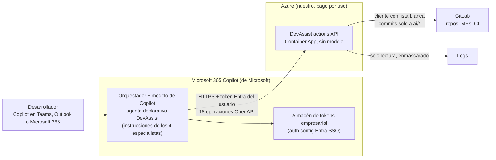

# Alternativa: DevAssist como agente declarativo de Microsoft 365 Copilot

Alternativa a la guía [Teams-AI-Agents-Microsoft-Foundry.md](../Teams-AI-Agents-Microsoft-Foundry.md)
(Foundry + Azure OpenAI GPT-5). Código en [`m365-copilot/`](../m365-copilot/README.md) y prueba en
[`tests/test_m365_actions.py`](../tests/test_m365_actions.py). Precios y documentación consultados el
**10 de noviembre de 2026**.

## Índice

- [Qué es](#qué-es)
- [Qué cubre de la guía](#qué-cubre-de-la-guía)
- [Suscripciones y licencias](#suscripciones-y-licencias)
- [Coste estimado para 5 y 20 desarrolladores](#coste-estimado-para-5-y-20-desarrolladores)
- [Pros](#pros)
- [Contras](#contras)
- [Despliegue paso a paso](#despliegue-paso-a-paso)
- [Qué está verificado aquí y qué no](#qué-está-verificado-aquí-y-qué-no)
- [Fuentes](#fuentes)

## Qué es

DevAssist deja de ser un servicio con modelos propios y pasa a ser un **agente declarativo** de
Microsoft 365 Copilot. El agente es un paquete de configuración: un manifiesto de app, unas
instrucciones y un **plugin de API** (las "acciones"). El orquestador y el modelo son los de Copilot:
deciden qué especialista toca, escriben los tests y la documentación y diagnostican los fallos. No hay
despliegues de GPT-5 que pagar.

Lo que debe ser código sigue siendo código. Es una pequeña API, la **DevAssist actions API**, que reutiliza
`src/devassist`: el cliente de GitLab con lista blanca, el enmascarado, el almacén de logs, el agrupado
de errores y la mitad "medidora" del agente de tests.



### Quién hace qué

| Paso | Foundry (guía) | Esta alternativa |
| --- | --- | --- |
| Enrutar al especialista | GPT-5 mini en nuestro servicio | Copilot, con las instrucciones de `instruction.txt` |
| Escribir tests y documentación, diagnosticar | GPT-5 en nuestro servicio | Modelo de Copilot (no lo elegimos ni lo vemos) |
| Llamar a GitLab, contar errores, enmascarar, medir CI | Nuestro código | El mismo código, ahora detrás de una API |
| Abrir la MR de tests | Nuestro código, si el pipeline pasa | Igual: la abre la API, nunca el modelo |

### El bucle de tests como trabajo asíncrono

Una acción de plugin no puede esperar minutos a que acabe el CI. Por eso el bucle de la guía se
convierte en un trabajo con estado:

1. Copilot llama a `getMergeRequestChanges`, que devuelve el diff, los ficheros cambiados, un test de
   ejemplo y las reglas del equipo. Con eso escribe un fichero de test.
2. `startTestRun` valida la ruta (solo ficheros de test, nunca `.gitlab-ci.yml` ni código de producción;
   si el nombre ya existe usa `<nombre>_ai.py`). Responde **al instante** con un `run_id` y, en segundo
   plano, crea `ai/tests-*`, hace commit, lanza el pipeline y espera.
3. `getTestRun` devuelve el estado y un `next_step` que le dice a Copilot qué hacer:
   - `passed`: la API ya abrió la MR. Tests añadidos, pasados y fallidos, y cobertura antes y después,
     **medidos por código**.
   - `failed`: incluye el log del job enmascarado. Si el test está mal, `retryTestRun` con el fichero
     corregido. Si el código está mal, `reportBugInCode`, que cierra sin MR.
   - `gave_up`: se agotaron los intentos (3 por defecto). No hay MR.
4. Los trabajos se guardan en un JSON y, si el servicio se reinicia, retoma la espera de los pipelines en curso.

En la práctica el desarrollador pide los tests, Copilot contesta "CI en marcha en `ai/tests-…`" y,
cuando el desarrollador pregunta "¿cómo va?", Copilot consulta el resultado y decide si corrige. La
guía, en cambio, contesta sola al terminar.

### Quién autentica al usuario ante la API

1. El plugin declara `OAuthPluginVault` con el `reference_id` de una **auth config de Microsoft Entra SSO**.
   Agents Toolkit la crea con `oauth/register` e `identityProvider: MicrosoftEntra`, y se puede gestionar
   en el Teams Developer Portal. Se guarda en el almacén de tokens empresarial de Microsoft.
2. Al usar una acción, **Microsoft 365 Copilot** obtiene para el usuario conectado un token delegado
   de Entra con el ámbito `DevAssist.Use` de nuestra app registrada (`aad.manifest.json`). El cliente del
   almacén de tokens (`ab3be6b7-f5df-413d-ac2d-abf1e3fd9c0b`) está preautorizado y la URI de redirección
   es la de Teams. El token llega a la API en la cabecera `Authorization: Bearer`.
3. **La API valida el token** (`m365-copilot/src/devassist_actions/auth.py`): la firma con las claves
   publicadas del tenant, el emisor, el tenant (los invitados de otros tenants reciben un 403), la
   audiencia (`api://<client id>` y la URI de aplicación de la auth config SSO) y el ámbito `DevAssist.Use`.
4. Con la identidad del token se resuelve "asignadas a mí", se decide de quién es cada `run_id` (nadie
   ve los trabajos de otro) y se rellena la auditoría. **GitLab se sigue llamando con la cuenta bot**,
   con sus permisos mínimos. Sin tenant configurado la API funciona en modo anónimo y entonces se niega
   a escuchar fuera de 127.0.0.1.

## Qué cubre de la guía

| Punto de la guía | Estado | Motivo |
| --- | --- | --- |
| **Agente de tests** | 🟡 Parcial | El bucle fijo está completo: rama `ai/tests-*`, CI real, hasta 3 intentos, distinción entre fallo del test y fallo del código, y MR solo en verde. La diferencia es que es **conversacional**: Copilot no puede esperar al CI ni avisar al terminar, así que el usuario pregunta por el resultado. Tampoco se elige el modelo (GPT-5 en la guía): los tests los escribe el modelo de Copilot. |
| **Agente de documentación** | ✅ Cubierto | Referencia de API (`docs/api.md` + enlace en el README), changelog construido por código desde las MRs fusionadas y docstrings en Python con comparación del árbol sintáctico, que rechaza cualquier cambio de código. Todo como MR. Los docstrings van de fichero en fichero. |
| **Agente Git** | ✅ Cubierto | Listar MRs ("asignadas a mí" con la identidad de Entra), crear ramas, comentar MRs, crear issues y ver el estado de pipelines. |
| **Agente de trazas** | ✅ Cubierto | Rango temporal en inglés y español, errores agrupados y **contados por código**, muestras enmascaradas, despliegues de la ventana, pipeline rojo con el log enmascarado, stack traces pegados e issue con el diagnóstico. |
| **Interfaz Teams** | 🟡 Parcial | El agente vive en **Copilot**: en Teams (chat de Copilot), en Outlook y en la app de Microsoft 365. No es un bot que se pueda @mencionar en canales o chats de grupo como el de la guía, y no encontré documentación oficial que lo confirme para agentes declarativos. |
| **Microsoft 365 Copilot** | ✅ Cubierto | Es su forma nativa: agente declarativo con plugin de API (manifiesto de app 1.25, agente declarativo v1.9, plugin v2.4). |
| **Webhooks / automatizaciones** | ❌ No | Un agente declarativo solo responde al usuario y no hay disparadores de GitLab. Para proponer tests al abrir una MR haría falta el servicio de la guía (`automations.py`) con modelo propio, que vuelve a costar tokens. |
| **Garantías de seguridad** | ✅ Cubierto | Todo pasa por el `GitLabClient` con lista blanca: sin merge, despliegue ni borrado (la API no tiene esas rutas, y hay un test que compara las rutas con el OpenAPI). Commits solo a `ai/*`, lista blanca de proyectos, enmascarado de logs y logs de jobs, y nunca se sobrescribe un test escrito por una persona. Además, Copilot pide **confirmación al usuario** antes de cada operación que escribe. |
| **Datos en la UE** | 🟡 Parcial | La API se despliega en una región de la UE. El procesamiento del modelo lo hace Microsoft 365 Copilot bajo los compromisos de residencia de Microsoft 365 del tenant (EU Data Boundary), no con un despliegue "Data Zone EU" que controlemos. Confírmalo con el delegado de protección de datos; no está verificado aquí. |
| **Auditoría y coste** | 🟡 Parcial | La API registra cada acción (usuario, operación, estado, ms), cada llamada a GitLab y cada denegación. No hay recuento de tokens, porque el modelo es de Copilot y no los expone. El coste deja de depender de los tokens y pasa a ser licencias (ver abajo). Las interacciones de Copilot quedan en la auditoría de Microsoft 365 (Purview), que no he comprobado. |

## Suscripciones y licencias

Precios de lista en USD, consultados el 10/11/2026.

| Concepto | Precio | Fuente |
| --- | --- | --- |
| Microsoft 365 Copilot (empresa, complemento) | **30,00 $/usuario/mes** con pago anual; 31,50 $ con pago mensual y compromiso anual. Requiere un plan de Microsoft 365 apto. | [microsoft.com – Copilot enterprise](https://www.microsoft.com/en-us/microsoft-365-copilot/enterprise) |
| Microsoft 365 Copilot Business (complemento, hasta 300 usuarios) | **21,00 $/usuario/mes** anual. Promoción de **18,00 $** el primer año para contrataciones entre el 1/7/2026 y el 31/12/2026. 25,20 $ con pago mensual. | [microsoft.com – Copilot pricing](https://www.microsoft.com/en-us/microsoft-365-copilot/pricing) |
| Microsoft 365 Business Standard / Premium con Copilot (paquetes) | 23,50 $ / 32,00 $ por usuario y mes, anual | [microsoft.com – Copilot pricing](https://www.microsoft.com/en-us/microsoft-365-copilot/pricing) |
| Microsoft 365 Copilot Chat | **Incluido** en los planes de Microsoft 365 aptos, sin coste adicional | [Plan licensing and cost](https://learn.microsoft.com/en-us/microsoft-365/copilot/extensibility/cost-considerations) |
| Pago por uso de agentes en Copilot Chat (medidor) | **0,01 $ por mensaje**, facturado a una suscripción de Azure. Desactivado por defecto. | [Meters for Copilot pay-as-you-go](https://learn.microsoft.com/en-us/copilot/microsoft-365/pay-as-you-go/pay-as-you-go-meters) |
| Tarifas en Copilot Credits (referencia) | Respuesta generativa 2 créditos, acción de agente 5, grounding en datos del tenant 10. **Sin cargo para usuarios con licencia de Microsoft 365 Copilot** | [Copilot Studio billing rates](https://learn.microsoft.com/en-us/microsoft-copilot-studio/requirements-messages-management) |

**Qué necesita cada usuario.** Según la tabla oficial de capacidades por licencia
([prerrequisitos](https://learn.microsoft.com/en-us/microsoft-365-copilot/extensibility/prerequisites)
y [costes](https://learn.microsoft.com/en-us/microsoft-365/copilot/extensibility/cost-considerations)):

- Un agente declarativo con **instrucciones y acciones personalizadas**, sin grounding en SharePoint,
  conectores ni correo, como este, está disponible en **Copilot Chat sin licencia de Copilot ni pago
  por uso**. La documentación lo describe como "lightweight extensibility" sin cargo, con "límites de
  uso". Esto contradice la idea de partida de que hacían falta licencias: **en teoría el agente
  funciona con la cuenta normal de Microsoft 365**. No lo he podido probar sin tenant.
- La licencia de Microsoft 365 Copilot elimina cualquier cargo por uso y los límites de Copilot Chat,
  activa el modo desarrollador (`-developer on`) para depurar y lleva Copilot a Word, Excel, Outlook y
  Teams. Es lo que necesita **quien desarrolla y prueba** el agente.
- Para construirlo y publicarlo: un tenant con la **subida de apps personalizadas** activada y un
  administrador que apruebe la app. Agents Toolkit es gratuito.
- Las acciones sobre un backend propio están permitidas: es el caso de uso de los plugins de API y
  admiten Entra SSO, OAuth (código de autorización con PKCE), clave de API o sin autenticación. Las
  cuentas GCC no admiten acciones autenticadas
  ([known issues](https://learn.microsoft.com/en-us/microsoft-365-copilot/extensibility/known-issues)).

**Lo que sigue en Azure (nuestro):** solo el hospedaje de la API. Precios de lista de Sweden Central
según la [API de precios de Azure](https://prices.azure.com/api/retail/prices) y la
[página de Container Apps](https://azure.microsoft.com/pricing/details/container-apps/):

- Container Apps: vCPU activa a 0,000024 $/s e inactiva a 0,000003 $/s; memoria a 0,000003 $/GiB·s.
  Gratis cada mes: 180 000 vCPU·s, 360 000 GiB·s y 2 M de peticiones.
- Container Registry Basic: 0,1666 $/día.
- Key Vault y Application Insights, como en la guía.

## Coste estimado para 5 y 20 desarrolladores

**Supuestos:**

- Una Container App de 0,25 vCPU y 0,5 GiB con **1 réplica siempre encendida**, porque espera a los
  pipelines en segundo plano, y casi siempre inactiva: unos 4 $/mes tras el cupo gratuito. Registry
  Basic, unos 5 $/mes. Key Vault y logs, céntimos (menos de 5 GB al mes). **Unos 10 $/mes en total**,
  igual para 5 que para 20 personas.
- Sin tokens de modelo: los pone Copilot.
- La carga de la guía para 20 personas: 200 peticiones de tests, 100 de documentación, 300 de trazas y
  1000 operaciones Git al mes. Las 300 revisiones automáticas de MR no existen aquí (no hay webhooks).
- No se cuentan las licencias de Microsoft 365 que la empresa ya paga (Teams y Copilot Chat).

| Escenario | 5 desarrolladores | 20 desarrolladores |
| --- | --- | --- |
| **A. Copilot Chat, sin licencias** (si se confirma que las acciones no se miden) | **~10 $/mes** | **~10 $/mes** |
| A′. Lo mismo, pero con pago por uso aplicando las tarifas de Copilot Studio (cota superior prudente, ver nota) | ~55 $/mes | ~195 $/mes |
| **B. Licencias Microsoft 365 Copilot (empresa, 30 $)** | 150 $ + 10 $ = **~160 $/mes** | 600 $ + 10 $ = **~610 $/mes** |
| B′. Copilot Business (21 $; 18 $ en promoción el primer año) | 105–90 $ + 10 $ = **~100–115 $/mes** | 420–360 $ + 10 $ = **~370–430 $/mes** |
| Referencia: guía Foundry | ~40 $/mes | ~155 $/mes |

Nota sobre A′: es una estimación propia por si el tenant activa el pago por uso y Microsoft midiera
este agente como uno de Copilot Studio. Para 20 personas, unas 2000 respuestas a 2 créditos y unas
2900 llamadas a acciones a 5 créditos dan unos 18 500 créditos, a 0,01 $ cada uno unos 185 $, más el
hospedaje. Para 5 personas, una cuarta parte. Según la documentación actual este agente no debería
pagar nada por uso, porque no usa datos del tenant.

**Lectura:** si las licencias se compran **solo para DevAssist**, sale entre 2,5 y 4 veces más caro que
Foundry. Si la empresa ya tiene licencias de Copilot por otros motivos, o si el escenario A se
confirma, sale **más barato** que Foundry, porque desaparecen los tokens.

## Pros

- **Sin modelos que desplegar ni pagar.** Sin cuotas de Azure OpenAI ni recuento de tokens, y sin
  ajustes de razonamiento ni de tiempo de espera del modelo.
- **Infraestructura mínima:** una API sin estado de modelo, unos 10 $/mes. Sin Bot Service ni Foundry.
- **Integración nativa en Copilot:** en Teams, Outlook y la app de Microsoft 365, con la identidad de
  Entra del usuario mediante SSO y las tarjetas de confirmación de Copilot antes de cada escritura.
- **Las garantías se mantienen en código:** lista blanca, `ai/*`, enmascarado, métricas medidas y MR
  solo en verde. El modelo de Copilot no puede saltárselas porque no habla con GitLab directamente.
- **Mejora sola:** cuando Microsoft mejora el modelo de Copilot, el agente mejora sin cambios nuestros.
- **Posible coste cero en licencias** si el escenario A se confirma en el tenant.

## Contras

- **Licencias por puesto** si se quiere Copilot completo: 30 $ por usuario y mes (21 $ en Business),
  más caro que Foundry si se compran solo para esto.
- **No hay automatizaciones:** sin webhooks de GitLab ni avisos proactivos. Los tests no se proponen al
  abrir una MR y el resultado del CI hay que pedirlo.
- **No se elige el modelo:** no se puede fijar GPT-5 para tests y GPT-5 mini para Git, ni controlar
  el razonamiento o la temperatura. La batería de release (`devassist eval`) **no se puede ejecutar**
  contra Copilot de forma automática: el comportamiento del modelo solo se prueba a mano.
- **Límites de la plataforma:** las instrucciones tienen como máximo 8000 caracteres. El OpenAPI no
  admite objetos anidados en las peticiones ni `oneOf/anyOf/allOf`, y hay que dar el fichero completo
  en cada llamada. Las respuestas se recortan a 20 000 caracteres (configurable): no encontré un límite
  oficial publicado, y la página de Learn que hablaba del tiempo máximo de respuesta ya no existe
  (404). Por eso todas las llamadas están diseñadas para responder en menos de un segundo.
- **Fuera de los canales de Teams:** el agente está en el chat de Copilot, no en los canales del equipo.
- **Menos visibilidad:** no vemos los prompts ni los tokens, solo nuestras llamadas a la API.
- **Una sola réplica:** los trabajos de test se guardan en un fichero. Para varias réplicas haría falta
  un almacén compartido (Table Storage o Redis).

## Despliegue paso a paso

Necesitas un tenant de Microsoft 365 con la subida de apps personalizadas activada (Teams admin center →
Teams apps → Setup policies → Upload custom apps), una cuenta con acceso a Copilot (una licencia para
el desarrollador, recomendable por el modo desarrollador), una suscripción de Azure para la API, la
cuenta bot de GitLab de la guía, [Azure CLI](https://learn.microsoft.com/cli/azure/install-azure-cli) y
[Microsoft 365 Agents Toolkit](https://aka.ms/M365AgentsToolkit) (extensión de VS Code o la CLI `atk`).

### 1. Validar en local (gratis)

```bash
devassist-actions validate --env local
```

```bash
devassist-actions package --env local
```

### 2. Desplegar la API en una región de la UE

```bash
az group create --name rg-devassist-m365 --location swedencentral
```

```bash
az acr create --resource-group rg-devassist-m365 --name <registro> --sku Basic
```

```bash
az acr build --registry <registro> --image devassist-actions:1.0.0 --file m365-copilot/Dockerfile .
```

```bash
az containerapp up --name devassist-actions --resource-group rg-devassist-m365 --image <registro>.azurecr.io/devassist-actions:1.0.0 --ingress external --target-port 3982 --env-vars GITLAB_URL=https://gitlab.tuempresa.com GITLAB_PROJECTS=grupo/payments-api DEVASSIST_ACTIONS_TENANT_ID=<id del tenant> DEVASSIST_ACTIONS_AUDIENCES=api://pendiente
```

Guarda el token de GitLab como secreto de la Container App (o en Key Vault con identidad administrada)
y pásalo como `GITLAB_TOKEN=secretref:gitlab-token`. Pon una réplica mínima (`--min-replicas 1`) y monta
un volumen en `/home/devassist/data` para que los trabajos sobrevivan a una revisión nueva.

### 3. Aprovisionar con Agents Toolkit

1. En `m365-copilot/env/.env.dev` pon `DEVASSIST_ACTIONS_URL` (la URL https de la Container App, sin `/api`)
   y los datos de la empresa (nombre, web, privacidad, condiciones, correo de contacto).
2. Inicia sesión en Microsoft 365 desde Agents Toolkit y comprueba que aparecen *Custom App Upload Enabled*
   y *Copilot Access Enabled*.
3. Desde `m365-copilot/` lanza **Provision**, o en la terminal:

```bash
atk provision --env dev
```

Esto crea la app de Entra, la auth config de Entra SSO, la app en el Teams Developer Portal y la
publica para tu usuario en Microsoft 365 Copilot. El orden de `m365agents.yml` es: `aadApp/create`,
`teamsApp/create`, `oauth/register`, `aadApp/update`, validación, zip, `teamsApp/update` y
`teamsApp/extendToM365`.

### 4. Cerrar la audiencia de la API

Con los valores que Provision escribió en `env/.env.dev`:

```bash
az containerapp update --name devassist-actions --resource-group rg-devassist-m365 --set-env-vars DEVASSIST_ACTIONS_AUDIENCES=api://<AAD_APP_CLIENT_ID>,<AAD_APP_CLIENT_ID>,<ENTRA_SSO_APPLICATION_ID_URI>
```

### 5. Probar en Copilot

En Teams, abre **Copilot**, elige **DevAssist** en la lista de agentes y prueba los iniciadores de
conversación. La primera vez Copilot pide permiso para enviar datos a la API ("Permitir siempre" en
las lecturas). Con licencia, `-developer on` muestra qué función eligió el orquestador y con qué datos.

### 6. Publicar para la organización

```bash
atk publish --env dev
```

El administrador lo aprueba en el centro de administración de Microsoft 365 (Agents / Integrated apps)
y puede limitarlo a un grupo, que es lo que pide el piloto de la guía.

### 7. GitLab

Igual que en la guía: un bot con rol Developer solo en los proyectos del piloto, y `main`/`develop`
protegidas con "Allowed to merge: Maintainers".

## Qué está verificado aquí y qué no

**Verificado en esta máquina (10/11/2026):**

- `python -m pytest`: **110 tests en verde** (unos 95 s), incluidos 13 nuevos en `tests/test_m365_actions.py`.
  Cubren:
  - el bucle de tests contra el GitLab de pruebas con **pytest real como CI**: MR !231 en verde con
    6 tests pasando, cobertura 38 % → 100 % y la MR abierta solo después;
  - la corrección tras un test mal escrito;
  - el bug real de la MR !232 cerrado sin MR, y el tope de intentos;
  - las rutas prohibidas, los proyectos fuera de la lista blanca, los docstrings que cambian código y
    que no se sobrescriben tests de personas;
  - la documentación como MRs, y las trazas contadas y enmascaradas;
  - la validación de tokens de Entra (firma, audiencia, caducidad, tenant ajeno y ámbito), la propiedad
    de los trabajos y la auditoría sin tokens;
  - el modo anónimo solo en loopback, la reanudación tras un reinicio y que las rutas de la API
    coinciden con el OpenAPI y ninguna fusiona, despliega ni borra.
- **Prueba en vivo por HTTP**: el sustituto de GitLab en el puerto 8932 y la API en el 3982 recorrieron
  el flujo completo. Todas las llamadas respondieron en menos de 200 ms (la más lenta,
  `getMergeRequestChanges`, 169 ms) y el trabajo de tests pasó de `starting` a `passed` con la MR abierta.
- **Validación contra los esquemas oficiales**, descargados hoy de developer.microsoft.com y
  spec.openapis.org: el manifiesto de app 1.25, el agente declarativo v1.9, el plugin v2.4, el OpenAPI
  3.0 y `m365agents.yml` (esquema de Agents Toolkit v1.10). También se comprueban las reglas de Copilot
  que el esquema no expresa (funciones = operationIds, sin cuerpos anidados ni `oneOf`, confirmación en
  cada escritura, 8000 caracteres de instrucciones) y se comprobó que el validador detecta errores
  introducidos a propósito. Los esquemas de Microsoft declaran draft-04 pero usan `const`; el validador
  lo tiene en cuenta.
- Se genera el zip del paquete (`appPackage/build/appPackage.local.zip`).

**No verificado (necesita tenant, licencia o pago):**

- `atk provision` y `atk publish`, la creación real de la app de Entra y de la auth config SSO, y la
  subida a Teams. `teamsApp/validateAppPackage` aplica reglas propias además del esquema, y no se ha
  ejecutado.
- Que Copilot elija bien las funciones, escriba tests razonables y siga `next_step`. En los tests, ese
  papel lo hace el propio test.
- Los tokens reales que envía Copilot: se probó con JWT firmados en local con el mismo formato que los
  de Entra v2.
- Que un usuario **sin licencia** pueda usar el agente sin coste (escenario A) y los "límites de uso"
  de Copilot Chat.
- Los límites reales de tiempo y tamaño de respuesta de los plugins.
- La imagen Docker (no se ha construido) y los comandos `az` (no hay Azure CLI ni suscripción).
- Dónde procesa Copilot los datos (EU Data Boundary) y su auditoría en Purview.

## Fuentes

- [Declarative agent schema 1.9](https://learn.microsoft.com/en-us/microsoft-365-copilot/extensibility/declarative-agent-manifest-1.9) — Microsoft Learn
- [Plugin manifest schema 2.4](https://learn.microsoft.com/en-us/microsoft-365-copilot/extensibility/api-plugin-manifest-2.4) — Microsoft Learn (también describe las acciones MCP, `RemoteMCPServer`)
- [Configure authentication for MCP and API plugins](https://learn.microsoft.com/en-us/microsoft-365/copilot/extensibility/plugin-authentication) y [Entra SSO](https://learn.microsoft.com/en-us/microsoft-365-copilot/extensibility/plugin-authentication-entra-sso) — Microsoft Learn
- [Build API plugins from an existing API](https://learn.microsoft.com/en-us/microsoft-365-copilot/extensibility/build-api-plugins-existing-api) y [OpenAPI guidance](https://learn.microsoft.com/en-us/microsoft-365-copilot/extensibility/openapi-document-guidance) — Microsoft Learn
- [Known issues (OpenAPI no soportado, GCC)](https://learn.microsoft.com/en-us/microsoft-365-copilot/extensibility/known-issues) — Microsoft Learn
- [Prerequisites and licensing models](https://learn.microsoft.com/en-us/microsoft-365-copilot/extensibility/prerequisites) y [Plan licensing and cost](https://learn.microsoft.com/en-us/microsoft-365/copilot/extensibility/cost-considerations) — Microsoft Learn
- [Copilot pay-as-you-go overview](https://learn.microsoft.com/en-us/copilot/microsoft-365/pay-as-you-go/overview) y [meters](https://learn.microsoft.com/en-us/copilot/microsoft-365/pay-as-you-go/pay-as-you-go-meters) — Microsoft Learn
- [Copilot Studio billing rates](https://learn.microsoft.com/en-us/microsoft-copilot-studio/requirements-messages-management) — Microsoft Learn
- [Microsoft 365 Copilot enterprise](https://www.microsoft.com/en-us/microsoft-365-copilot/enterprise) y [pricing](https://www.microsoft.com/en-us/microsoft-365-copilot/pricing) — Microsoft
- [Customize app manifest in Agents Toolkit](https://learn.microsoft.com/en-us/microsoftteams/platform/toolkit/teamsfx-preview-and-customize-app-manifest) y el [esquema de m365agents.yml v1.10](https://aka.ms/m365-agents-toolkits/v1.10/yaml.schema.json) — Microsoft
- [Azure Container Apps pricing](https://azure.microsoft.com/pricing/details/container-apps/) y [Azure Retail Prices API](https://prices.azure.com/api/retail/prices) — Microsoft Azure
