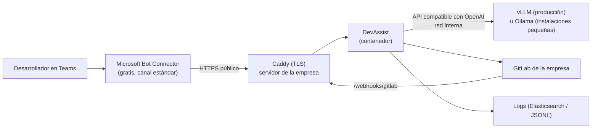

# Alternativa: modelos abiertos en servidor propio (sin nube de IA)

Precios y datos consultados el **10 de noviembre de 2026**. Los precios de hardware se mueven
mucho (escasez de memoria GDDR7 en 2026): compruébalos antes de comprar.

## Índice

- [Qué es](#qué-es)
- [Qué cubre de la guía](#qué-cubre-de-la-guía)
- [Suscripciones, licencias y hardware](#suscripciones-licencias-y-hardware)
- [Coste estimado para 5 y 20 desarrolladores](#coste-estimado-para-5-y-20-desarrolladores)
- [Pros](#pros)
- [Contras](#contras)
- [Despliegue paso a paso](#despliegue-paso-a-paso)
- [Qué está verificado aquí y qué no](#qué-está-verificado-aquí-y-qué-no)

## Qué es

El mismo DevAssist de [DEVASSIST.md](DEVASSIST.md) (orquestador + agentes de tests, docs, Git y
trazas, con los mismos bloqueos y el mismo enmascarado), pero **sin Azure OpenAI ni ninguna otra
nube de IA**: los modelos son de pesos abiertos y corren en un servidor con GPU de la empresa
(o alquilado en exclusiva). Lo único que pasa por Microsoft es la conexión con Teams.



Qué se ha añadido en esta rama:

| Pieza | Dónde |
| --- | --- |
| Perfil genérico `openai-compatible`: URL base, modelo fuerte y rápido, API key opcional, URL aparte para el modelo rápido y cómo se envía el nivel de razonamiento | `src/devassist/config.py`, `src/devassist/llm.py` |
| `devassist doctor` comprueba que el servidor responde y sirve los dos modelos | `src/devassist/cli.py` |
| 14 tests contra un servidor de modelos simulado (forma de la petición, clave, razonamiento, llamadas a herramientas, dos servidores, doctor) | `tests/test_devassist_self_hosted.py` |
| `docker-compose.yml` con Caddy (TLS), DevAssist, Ollama en CPU por defecto y vLLM en GPU con `--profile gpu` | `deploy/self-hosted/` |
| Ejemplos de configuración | `deploy/self-hosted/.env.example`, `.env.devassist.example` |

El perfil vale para cualquier servidor que hable la API de OpenAI (vLLM, el `/v1` de Ollama,
llama.cpp server, LiteLLM…). El razonamiento se envía de tres formas, según el modelo:

| `OPENAI_COMPATIBLE_REASONING_MODE` | Qué envía | Para |
| --- | --- | --- |
| `effort` (por defecto) | `reasoning_effort` | gpt-oss en vLLM (`low`/`medium`/`high`), Ollama (`none` apaga el razonamiento de qwen3) |
| `thinking-flag` | `chat_template_kwargs.enable_thinking` | Qwen3 híbrido en vLLM, que ignora `reasoning_effort` ([documentación de Qwen](https://qwen.readthedocs.io/en/latest/deployment/vllm.html)) |
| `omit` | nada | Modelos sin razonamiento, como Qwen3-30B-A3B-Instruct-2507 |

## Qué cubre de la guía

| Punto de la guía | Estado | Por qué |
| --- | --- | --- |
| Agente de tests | Cubierto | El mismo código y el mismo bucle fijo (rama `ai/*`, CI, hasta 3 intentos, MR). La calidad depende del modelo: ver [Contras](#contras). |
| Agente de documentación | Cubierto | Mismo código. La comparación del árbol sintáctico descarta cualquier cambio que no sea documentación, así que un modelo más flojo no puede romper código. |
| Agente Git | Cubierto | Necesita llamadas a herramientas: vLLM las soporta con `--enable-auto-tool-choice` y el parser del modelo (`openai` para gpt-oss, `hermes` para Qwen3). Las URLs inventadas ya se eliminan en código. |
| Agente de trazas | Cubierto | Los recuentos los hace el código y el modelo solo diagnostica. Logs en Elasticsearch o JSONL; Log Analytics queda fuera porque es de Azure. |
| Interfaz Teams | Cubierto, con condiciones | Mismo endpoint `/api/messages`. Teams solo llama a HTTPS público con certificado de confianza, así que hace falta abrir 443 (o un túnel) y registrar el bot. El registro puede hacerse sin suscripción de Azure (bot "gestionado por Teams") si no se necesita OAuth/SSO, y DevAssist no lo necesita. |
| Microsoft 365 Copilot | Parcial | El paquete ya declara el agente para Copilot y el bot es el mismo, pero usarlo en Copilot Chat exige la licencia de Microsoft 365 Copilot (30 $/usuario/mes, [precios](https://www.microsoft.com/en-us/microsoft-365-copilot/pricing/copilot-studio)). Además, el registro gestionado por Teams no tiene configuración avanzada de canales; puede que haga falta migrar a Azure Bot. No probado. |
| Webhooks y automatizaciones de GitLab | Cubierto | Mismo código. Con GitLab en la red interna, el webhook ni siquiera tiene que salir a internet (se puede llamar a DevAssist directamente, sin Caddy). |
| Garantías de seguridad | Cubierto | Todas siguen en código (sin merge/deploy/delete, ramas `ai/*`, lista blanca de proyectos, enmascarado, tenant, webhooks firmados). Cambia el secreto del bot: en Azure era identidad administrada; aquí es un secreto de cliente en `.env`. El servidor de modelos solo escucha en la red interna de Docker y lleva API key. |
| Datos en la UE | Cubierto (los modelos) / parcial (Teams) | Prompts, código y logs solo llegan al servidor propio, que puede estar en la oficina o en un centro de datos de la UE. Los mensajes de Teams pasan por el Bot Connector de Microsoft como en la guía; con Azure Bot se puede elegir residencia regional en `westeurope` ([Azure Bot](https://learn.microsoft.com/en-us/azure/bot-service/abs-quickstart)), con el bot gestionado por Teams no. |
| Auditoría y coste | Cubierto (auditoría) / cambia (coste) | `audit.jsonl` registra todo igual. El coste por token es 0 y el coste real es fijo (hardware o alquiler), así que el presupuesto de Azure con alertas deja de tener sentido. `devassist usage` sigue mostrando cuánto habría costado en Azure, útil para comparar. Application Insights no está: la telemetría queda en el fichero local. |

## Suscripciones, licencias y hardware

### Lo que no cuesta nada

| Pieza | Precio | Fuente |
| --- | --- | --- |
| vLLM (servidor de modelos de producción) | Gratis, Apache 2.0. Imagen oficial `vllm/vllm-openai` | [Docker](https://docs.vllm.ai/en/latest/deployment/docker.html), [tool calling](https://docs.vllm.ai/en/latest/features/tool_calling.html) |
| Ollama (instalaciones pequeñas) | Gratis, MIT | [ollama.com](https://ollama.com) |
| Caddy (TLS con Let's Encrypt automático) | Gratis, Apache 2.0 | [caddyserver.com](https://caddyserver.com) |
| Registro del bot de Teams sin Azure ("Teams-managed") | Gratis, sin suscripción de Azure; sin OAuth ni SSO | [Bot locations](https://microsoft.github.io/teams-sdk/cli/concepts/bot-locations) |
| Azure Bot, si se prefiere | Requiere suscripción de Azure (vale la cuenta gratuita). Teams es canal estándar: mensajes ilimitados en F0 y S1 | [precios de Bot Service](https://azure.microsoft.com/en-us/pricing/details/bot-services/), [requisitos](https://learn.microsoft.com/en-us/azure/bot-service/abs-quickstart) |
| Teams | La licencia que la empresa ya tiene | — |

**Confirmado**: Azure Bot Service con el canal de Teams necesita una suscripción de Azure, aunque no
genere ningún cargo (la guía de inicio rápido pide crear "a free account" si no se tiene). La vía
para no tener ninguna suscripción es el bot gestionado por Teams desde el
[Developer Portal](https://dev.teams.microsoft.com). Ojo: en un hilo de Microsoft Q&A se informa de
errores 401 en mensajes salientes con bots registrados solo en el Developer Portal
([hilo](https://learn.microsoft.com/en-us/answers/questions/5650695/single-tenant-teams-bot-(dev-portal-only)-gets-401)).
DevAssist envía la respuesta final como mensaje proactivo, así que hay que probarlo antes de decidir.

**Alternativa sin bot: webhooks salientes de Teams.** Funcionan sin registro de bot, pero
([documentación](https://learn.microsoft.com/en-us/microsoftteams/platform/webhooks-and-connectors/how-to/add-outgoing-webhook)):

- Hay que responder en **5 segundos**; una ejecución de tests tarda minutos.
- Solo en **canales públicos** con **@mención**, nunca en chat personal.
- No pueden enviar mensajes proactivos ni usar otras API de Teams; las tarjetas solo admiten `openURL`.
- Se autentican con HMAC-SHA256 por equipo.

Se podría contestar "On it…" en esos 5 s y publicar el resultado con un flujo de Workflows
(`TEAMS_NOTIFY_WEBHOOK_URL`), pero no está implementado y la experiencia es peor (todo a la vista de
todo el equipo). No se recomienda.

### Modelos de pesos abiertos

Todos con licencia Apache 2.0, que permite uso comercial. VRAM: lo que dice el fabricante cuando lo
dice; si no, una estimación (parámetros × bytes por parámetro, más la caché de contexto).

| Modelo | Parámetros (activos) | VRAM | Llamadas a herramientas en vLLM | Fuente |
| --- | --- | --- | --- | --- |
| gpt-oss-20b | 21B (3,6B), MoE | Cabe en 16 GB (MXFP4, oficial) | `--tool-call-parser openai` | [ficha](https://huggingface.co/openai/gpt-oss-20b), [receta vLLM](https://docs.vllm.ai/projects/recipes/en/latest/OpenAI/GPT-OSS.html) |
| gpt-oss-120b | 117B (5,1B), MoE | Una GPU de 80 GB (oficial) | `--tool-call-parser openai` | ídem |
| Qwen3-30B-A3B-Instruct-2507 | 30,5B (3,3B), MoE, contexto 262K | Estimado: ~61 GB en BF16, ~31 GB en FP8 | `--tool-call-parser hermes` | [ficha](https://huggingface.co/Qwen/Qwen3-30B-A3B-Instruct-2507) |
| Qwen3-8B | 8B, denso | Estimado: ~16 GB en BF16, ~8 GB en FP8 | `--tool-call-parser hermes` | [ficha](https://huggingface.co/Qwen/Qwen3-8B), [Qwen + vLLM](https://qwen.readthedocs.io/en/latest/deployment/vllm.html) |
| qwen3:8b / qwen3:4b (Ollama, Q4) | 8B / 4B | ~5 GB / ~2,5 GB (tamaño de descarga) | Ollama las soporta | [ollama.com/library/qwen3](https://ollama.com/library/qwen3) |

Recomendación: **gpt-oss-20b** para los dos niveles en una GPU de 24 GB, y **gpt-oss-120b** (o
Qwen3-30B-A3B en BF16) en una de 80–96 GB. Un MoE con ~3–5B activos responde tan rápido como un
modelo pequeño, así que usar el mismo modelo para "fuerte" y "rápido" simplifica (un solo proceso
de vLLM).

### Hardware: alquilar o comprar

**Alquilar un servidor dedicado (mensual, en la UE).** Hetzner, precios sin IVA
([tabla](https://www.hetzner.com/dedicated-rootserver/matrix-gpu/)):

| Servidor | GPU | Mes | Alta (una vez) | Ubicación |
| --- | --- | --- | --- | --- |
| GEX45 | RTX PRO 4000 Blackwell, 24 GB | 214 € | 209 € | Helsinki |
| GEX63 | RTX PRO 6000 Blackwell Max-Q, 96 GB | 999 € | 999 € | Helsinki |
| GEX131 | RTX PRO 6000 Blackwell Max-Q, 96 GB | desde 1.499 € | 1.499 € | Falkenstein, Helsinki |

**Alquilar por horas.** RunPod ([precios](https://www.runpod.io/pricing)), en dólares por hora,
nube segura / comunitaria: RTX 4090 0,89/0,34; L40S (48 GB) 1,09/0,79; A100 80 GB 1,79/1,19;
H100 SXM 3,99/2,69; RTX PRO 6000 2,49/1,69. Encendido todo el mes (730 h) sale más caro que
Hetzner; solo compensa para pruebas o encendiéndolo en horario laboral. Muchas de estas máquinas no
están en la UE ni son exclusivas: revisa la región y el tipo antes de enviarles código.

**Comprar.** Precios muy por encima del de lanzamiento en 2026:

- RTX PRO 6000 Blackwell 96 GB: mínimo de 15.390 € en la UE (19-sep-2026,
  [gpuprix](https://gpuprix.com/eu/gpus/rtx-pro-6000-blackwell)); lanzamiento a 8.565 $.
- RTX 5090 32 GB: más de 5.000 € en tiendas de la UE (14-sep-2026,
  [Guru3D](https://www.guru3d.com/story/geforce-rtx-5090-street-prices-in-eu-now-exceed/)); PVP oficial 2.099 €.
- Una GPU de 12 GB como la RTX 3060 de estas pruebas basta para qwen3:8b + qwen3:4b en Ollama.

## Coste estimado para 5 y 20 desarrolladores

Supuestos:

- Uso como el de la guía (unas pocas peticiones al día por persona). Con vLLM, una GPU atiende varias
  peticiones a la vez; con 20 personas rara vez coinciden más de 3–4.
- Compra amortizada a **36 meses**. El resto del equipo (CPU, RAM, disco, fuente) se estima en
  ~1.500 € para una estación de trabajo y ~3.000 € para un servidor; no son precios consultados.
- Electricidad a **0,20 €/kWh** con consumo medio de 200 W (estación) o 400 W (servidor) las 24 h.
- DevAssist y Caddy van en la misma máquina que el modelo: sin coste aparte.
- Teams y el registro del bot: 0 €. Precios de Hetzner sin IVA.
- No incluye las horas de administración (actualizar vLLM, drivers, modelos, copias). Cuenta al menos
  2–4 h al mes: con frecuencia es el coste mayor.

| Escenario | 5 desarrolladores | 20 desarrolladores |
| --- | --- | --- |
| Reutilizar una GPU de 12 GB que ya existe (qwen3:8b + qwen3:4b en Ollama, como en las pruebas) | ~10–15 €/mes de luz | No recomendable: una sola petición a la vez y calidad justa |
| Alquilar Hetzner GEX45 (24 GB, gpt-oss-20b) | **214 €/mes** + 209 € de alta | 214 €/mes, si la calidad de gpt-oss-20b basta (validar con `devassist eval`) |
| Alquilar Hetzner GEX63 (96 GB, gpt-oss-120b) | 999 €/mes (sobredimensionado) | **999 €/mes** + 999 € de alta |
| Comprar estación con RTX 5090 (~6.500 €) | ~180 € amortización + ~29 € luz ≈ **210 €/mes** | Igual, con gpt-oss-20b |
| Comprar servidor con RTX PRO 6000 (~18.400 €) | Sobredimensionado | ~511 € amortización + ~58 € luz ≈ **570 €/mes** |
| Referencia: la guía con Azure (GPT-5 + GPT-5 mini) | menos de 155 $/mes | ~155 $/mes |

Conclusión: con este volumen de uso **no ahorra dinero** frente a Azure (pago por token). Compensa
cuando los datos no pueden salir de la empresa, cuando ya hay GPU o cuando el uso crece mucho, porque
el coste es fijo y no sube con cada token.

## Pros

- **Ningún prompt, diff ni log sale a una nube de IA.** Solo los mensajes de Teams pasan por Microsoft,
  como cualquier chat de Teams. Facilita el visto bueno de protección de datos.
- **Sin suscripciones**: ni Azure (con el bot gestionado por Teams) ni proveedores de modelos.
- **Coste fijo y predecible**: no hay sorpresas por un bucle de reintentos ni por un diff enorme.
- **Modelos Apache 2.0**: se pueden fijar versiones y no desaparecen por una retirada del proveedor.
- **Mismo código**: cambiar de Azure a servidor propio son variables de entorno
  (`DEVASSIST_PROFILE=openai-compatible`); la batería `devassist eval` compara la calidad.
- **Funciona sin internet** para todo lo interno (GitLab, logs, modelos), salvo el canal de Teams.

## Contras

- **Calidad menor que GPT-5** en las tareas de juicio. Lo que se vio en las pruebas locales con
  qwen3:8b / qwen3:4b (en la rama principal y repetido aquí):
  - Con el razonamiento libre, el modelo gastó 3700 de 4000 tokens pensando y la respuesta llegó
    cortada. Hubo que **apagar el razonamiento** (`none`) por defecto y activarlo solo para decidir
    "¿falla el test o el código?", con el límite triplicado.
  - El razonamiento sin fin dejaba peticiones colgadas: hizo falta un **límite de tiempo** (180 s)
    por llamada.
  - Los modelos pequeños **inventan enlaces**: se eliminan en código todas las URLs que no vienen de GitLab.
  - Esa decisión test/código es la parte menos fiable con modelos de 4–8B.
  - Las muestras son pequeñas (7 casos): indican que funciona, no una tasa de acierto.
- **Cada familia de modelos pide su ajuste**: Qwen3 en vLLM ignora `reasoning_effort` (hay que usar
  `thinking-flag`), gpt-oss rechaza `none`, y cada uno necesita su `--tool-call-parser`. Un error aquí
  rompe las herramientas del agente Git sin que el servidor avise.
- **Operación propia**: drivers de NVIDIA, NVIDIA Container Toolkit, actualizaciones de vLLM, copias,
  monitorización y guardias. No hay SLA.
- **Exposición a internet**: Teams exige HTTPS público, así que hay que abrir 443 (o usar un túnel)
  hacia un servidor de la empresa. Caddy solo publica `/api/messages` y `/webhooks/gitlab`.
- **Hardware caro e inestable de precio en 2026**, y una GPU es un único punto de fallo (sin réplica).
- **Sin identidad administrada**: el bot usa un secreto de cliente que hay que rotar.
- Copilot Chat y la residencia regional del bot dependen de pasar a Azure Bot (y de licencias de Copilot).

## Despliegue paso a paso

Requisitos: un servidor Linux con Docker y Docker Compose; para vLLM, una GPU NVIDIA con el
[NVIDIA Container Toolkit](https://docs.nvidia.com/datacenter/cloud-native/container-toolkit/latest/install-guide.html);
un nombre DNS público que apunte al servidor con los puertos 80 y 443 abiertos.

### 1. Probar el perfil en local (sin servidor)

Con Ollama instalado y los modelos de [DEVASSIST.md](DEVASSIST.md), en `.env.devassist`:

```
DEVASSIST_PROFILE=openai-compatible
OPENAI_COMPATIBLE_BASE_URL=http://localhost:11434/v1
OPENAI_COMPATIBLE_MODEL_STRONG=qwen3:8b
OPENAI_COMPATIBLE_MODEL_FAST=qwen3:4b
```

```bash
.venv\Scripts\devassist doctor
```

```bash
.venv\Scripts\devassist eval --profile openai-compatible
```

### 2. Registrar el bot de Teams

Opción sin Azure: [Developer Portal](https://dev.teams.microsoft.com) → Tools → Bot management →
New bot. Endpoint: `https://<tu dominio>/api/messages`. Crea un secreto de cliente y anota el
identificador de la aplicación y el del tenant.

Opción con Azure (gratis, pero con suscripción): un recurso **Azure Bot** single-tenant, tarifa F0,
con el canal de Microsoft Teams. Permite residencia en `westeurope` y OAuth.

### 3. Configurar

```bash
cd deploy/self-hosted
```

```bash
cp .env.example .env
```

Rellena el dominio, las cuatro variables `CONNECTIONS__SERVICE_CONNECTION__SETTINGS__*`
(con `AUTHTYPE=ClientSecret`), el tenant, GitLab, los logs y una API key larga y aleatoria para el
servidor de modelos.

### 4. Arrancar

Sin GPU NVIDIA (Ollama en CPU, lento, para probar el circuito):

```bash
docker compose up -d --build
```

```bash
docker compose run --rm ollama-pull
```

Con GPU: descomenta el bloque de vLLM en `.env` (por defecto gpt-oss-20b) y:

```bash
docker compose --profile gpu up -d --build
```

La primera vez vLLM descarga el modelo (~13 GB para gpt-oss-20b) desde Hugging Face. Comprueba:

```bash
docker compose exec devassist devassist doctor
```

Antes de abrirlo a nadie, pasa la batería de release desde un equipo con el repositorio (la imagen
del servicio no trae pytest, que el GitLab simulado necesita). El servidor de modelos no publica
ningún puerto, así que añade temporalmente `ports: ["127.0.0.1:8000:8000"]` al servicio `vllm`,
abre un túnel SSH (`ssh -L 8000:127.0.0.1:8000 servidor`) y ejecuta, con
`OPENAI_COMPATIBLE_BASE_URL=http://localhost:8000/v1` y los mismos modelos y clave que en `.env`:

```bash
devassist eval --profile openai-compatible
```

`devassist eval` usa su propio GitLab simulado y no toca el de la empresa.

### 5. Publicar en Teams

```bash
docker compose exec devassist devassist package --bot-id <client id> --developer "Tu empresa" --website https://tuempresa.com --privacy-url https://tuempresa.com/privacidad --terms-url https://tuempresa.com/condiciones --output /data/devassist-teams.zip
```

Copia el zip fuera del contenedor (`docker compose cp devassist:/data/devassist-teams.zip .`) y súbelo
en Teams como en [DEVASSIST.md](DEVASSIST.md#6-publicar-en-teams-y-copilot).

### 6. Webhooks de GitLab

Igual que en la guía principal, con la URL `https://<tu dominio>/webhooks/gitlab` (o directa por
la red interna si GitLab está en la misma red).

### Cambiar de modelo

Cambia `VLLM_MODEL`, `VLLM_TOOL_PARSER` y los nombres en `.env`, reinicia y vuelve a pasar
`devassist eval` antes de dejarlo en producción. Para Qwen3-30B-A3B-Instruct-2507:
`VLLM_TOOL_PARSER=hermes`, `OPENAI_COMPATIBLE_REASONING_MODE=omit`. Para dos modelos distintos,
duplica el servicio `vllm` y usa `OPENAI_COMPATIBLE_BASE_URL_FAST`.

## Qué está verificado aquí y qué no

Verificado en esta máquina (Windows, RTX 3060 de 12 GB compartida):

EVAL_RESULTS_PLACEHOLDER

No verificado:

- **`docker-compose.yml` y `Caddyfile` no se han ejecutado**: en esta máquina no hay Docker. Solo se
  ha comprobado que el YAML es válido. Las etiquetas de imagen (`vllm/vllm-openai:v0.10.2`,
  `ollama/ollama:0.12.3`, `caddy:2.10`) están fijadas pero sin descargar.
- **vLLM no se ha ejecutado**: los parámetros (`--enable-auto-tool-choice`, `--tool-call-parser`,
  `VLLM_API_KEY`) salen de la documentación oficial y la forma de las peticiones está probada contra un
  servidor simulado, no contra vLLM real. gpt-oss y Qwen3-30B no se han probado.
- Teams real, el bot gestionado por Teams (incluidos los mensajes proactivos) y Copilot Chat.
- Los consumos de VRAM marcados como "estimado" y los costes de compra de equipo completo.
- El rendimiento con 20 personas a la vez.
