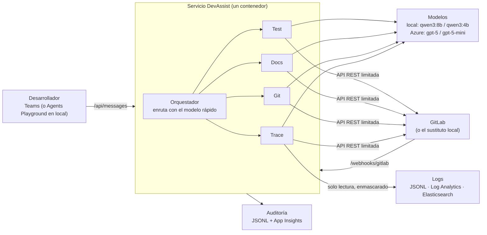

# DevAssist: qué se ha construido y cómo pasar a producción

Implementación de la guía [Teams-AI-Agents-Microsoft-Foundry.md](../Teams-AI-Agents-Microsoft-Foundry.md):
un orquestador (**DevAssist**) y cuatro agentes especialistas (tests, documentación, Git y trazas)
que se usan desde Microsoft Teams.

Todo lo que se puede hacer gratis está hecho y funciona en local con **Ollama**. Lo que exige pagar
o tener un tenant (GPT-5 en Azure, Teams real, Key Vault, Bot Service, presupuestos) está preparado
como código y configuración: el paso a producción es **cambiar variables de entorno y desplegar**,
no reescribir.

## Índice

- [Resumen en una tabla](#resumen-en-una-tabla)
- [Arquitectura](#arquitectura)
- [Arranque rápido gratis (Ollama)](#arranque-rápido-gratis-ollama)
- [Probarlo como si fuera Teams](#probarlo-como-si-fuera-teams)
- [Cómo trabaja cada agente](#cómo-trabaja-cada-agente)
- [Garantías de seguridad](#garantías-de-seguridad)
- [Control de costes y auditoría](#control-de-costes-y-auditoría)
- [Automatizaciones con webhooks de GitLab](#automatizaciones-con-webhooks-de-gitlab)
- [Comandos](#comandos)
- [Pruebas y resultados](#pruebas-y-resultados)
- [Paso a producción (Azure + Teams + Copilot)](#paso-a-producción-azure--teams--copilot)
- [Diferencias con la guía](#diferencias-con-la-guía)
- [Pendiente y limitaciones conocidas](#pendiente-y-limitaciones-conocidas)
- [Mapa de ficheros](#mapa-de-ficheros)

## Resumen en una tabla

| Punto de la guía | Estado | Dónde |
| --- | --- | --- |
| Orquestador DevAssist que enruta a 4 especialistas | ✅ Hecho y probado con modelos reales | `src/devassist/orchestrator.py` |
| Agente de tests: escribe, hace commit en `ai/tests-*`, lanza CI, lee el resultado, corrige hasta 3 veces, abre MR | ✅ Hecho y probado con modelos reales | `specialists.py` → `TestAgent` |
| Agente de documentación: `docs/api.md`, README, changelog, comentarios en código | ✅ Hecho | `DocsAgent` |
| Agente Git: ramas, listar MRs, comentar MRs, crear issues, estado de pipelines | ✅ Hecho y probado con modelos reales | `GitAgent` |
| Agente de trazas: logs por rango de tiempo, pipelines rojos, stack traces, borrador de issue | ✅ Hecho y probado con modelos reales | `TraceAgent` |
| GPT-5 para tests/docs, GPT-5 mini para Git/trazas/enrutado | ✅ Preparado (en local: qwen3:8b y qwen3:4b) | `llm.py` |
| Teams como interfaz | ✅ Servicio Bot compatible (Microsoft 365 Agents SDK), probado en Agents Playground | `server.py` |
| Publicación en Teams y Microsoft 365 Copilot | ✅ Paquete de app generado y validado contra el esquema v1.25 | `teams_package.py` |
| Webhooks de GitLab (MR abierta, MR fusionada, pipeline fallido) | ✅ Hecho, desactivado por defecto | `automations.py` |
| Nunca fusionar, desplegar ni borrar | ✅ Bloqueado en código, con tests | `gitlab.py` |
| Logs de solo lectura y enmascarado de datos personales | ✅ Hecho (JSONL local, Log Analytics, Elasticsearch) | `logstore.py`, `masking.py` |
| Auditoría de peticiones, herramientas, tokens y coste | ✅ Hecho | `audit.py` |
| Límite de tokens, rechazo de diffs grandes, presupuesto con alertas al 50/80/100 % | ✅ Hecho (el presupuesto, en Bicep) | `config.py`, `infra/main.bicep` |
| Instrucciones de los agentes versionadas y batería de pruebas antes de cada release | ✅ Hecho | `instructions/`, `eval_cases.yaml`, `.gitlab-ci.yml` |
| Infraestructura Azure (Foundry, despliegues Data Zone EU, Key Vault, App Insights, Bot, presupuesto) | 🟡 Escrita como Bicep, **sin compilar ni desplegar** | `infra/main.bicep` |
| Teams real, Copilot Chat, aprobación del administrador de M365 | ⏳ Requiere tenant y suscripción | [Paso a producción](#paso-a-producción-azure--teams--copilot) |

## Arquitectura



Una regla guía todo el diseño: **los hechos los mide el código y el modelo solo aporta juicio**.
Si los tests pasan lo dice el pipeline, los recuentos de errores los calcula el código y los
enlaces salen de GitLab. El modelo escribe tests y documentación y diagnostica causas, pero nunca
se le cree un número ni un enlace.

Se usa **Microsoft Agent Framework** (el mismo del resto del repositorio) para los agentes y las
llamadas a herramientas, y **Microsoft 365 Agents SDK** para hablar con Teams.

## Arranque rápido gratis (Ollama)

Requisitos: Python 3.10+, [Ollama](https://ollama.com) y unos 8 GB para los dos modelos.

```bash
python -m venv .venv
```

```bash
.venv\Scripts\pip install -e ".[dev]"
```

```bash
ollama pull qwen3:8b
```

```bash
ollama pull qwen3:4b
```

```bash
copy .env.devassist.example .env.devassist
```

En una terminal, el GitLab de pruebas (también genera logs de ejemplo con un incidente "ayer entre las 17:00 y las 18:00"):

```bash
.venv\Scripts\devassist fake-gitlab
```

En otra:

```bash
.venv\Scripts\devassist doctor
```

```bash
.venv\Scripts\devassist ask "Generate unit tests for `OrderService` in MR !231 of `payments-api`"
```

`fake-gitlab` es un sustituto local de GitLab: implementa la parte de la API REST que usan los
agentes y su "CI" ejecuta **de verdad** pytest con cobertura sobre el contenido de la rama. Trae dos
proyectos de ejemplo:

- `acme/payments-api` (rama `develop`): MR !231 correcta, MR !232 con un fallo a propósito
  (divide el descuento entre 10 en vez de 100), pipeline #5512 en rojo y un despliegue de ayer.
- `acme/customer-portal` (rama `main`): controladores para documentar.

> ⚠️ El sustituto ejecuta en tu máquina el código que generan los modelos, y por eso solo escucha en
> 127.0.0.1. En producción ese código corre en los runners de GitLab, nunca en el servicio.

Sin GPU ni Ollama también funciona todo con `--profile mock`, un modelo simulado sin conexión que
usan los tests automáticos.

## Probarlo como si fuera Teams

[Microsoft 365 Agents Playground](https://learn.microsoft.com/microsoft-365/agents-sdk/test-with-toolkit-project)
es la herramienta gratuita de Microsoft que imita Teams en el navegador.

```bash
npm install
```

```bash
.venv\Scripts\devassist serve
```

```bash
npm run playground
```

Se abre en http://localhost:56150. Escribe, por ejemplo: `Why is pipeline #5512 of payments-api red?`

Sin credenciales, el servicio funciona en modo anónimo, responde dentro de la misma petición y se
niega a escuchar en cualquier interfaz que no sea 127.0.0.1. Con credenciales (producción), contesta
"On it…" al momento y entrega la respuesta después, porque Teams solo espera unos segundos y una
ejecución de tests puede tardar minutos.

## Cómo trabaja cada agente

### Orquestador

1. Si el mensaje es `feedback good|bad <comentario>`, lo registra y termina.
2. Si en esa conversación hay un borrador de issue y el usuario dice "open the issue", lo crea.
3. Si no, pregunta al modelo rápido qué especialista toca (`test`, `docs`, `git`, `trace` o `help`).
   Si la respuesta no se entiende, enruta por palabras clave.

### Agente de tests (el bucle fijo de la guía)

1. Lee la MR (diff y ficheros cambiados) o busca la clase indicada en la rama por defecto.
   Si el diff supera `DEVASSIST_MAX_DIFF_CHARS`, se niega **antes de gastar un solo token**.
2. Toma un test existente como ejemplo de estilo y, si existe, `.devassist/testing-rules.md` del repositorio.
3. Crea la rama `ai/tests-<nombre>-<id>` desde la rama de la MR y pide al modelo fuerte un fichero de test.
4. Solo acepta rutas de test (nunca `.gitlab-ci.yml` ni código de producción) y nunca sobrescribe un test
   que haya escrito una persona: si el nombre ya existe, usa `<nombre>_ai.py`.
5. Hace commit, lanza el pipeline normal y espera el resultado.
6. Si falla, le pasa el log del job (enmascarado) al modelo, esta vez con razonamiento activado:
   - Si el test está mal, lo corrige y vuelve al paso 5, hasta 3 intentos.
   - Si el código está mal, se para e informa del bug **sin abrir MR**.
7. Si pasa, abre una MR hacia la rama original y responde, por ejemplo:
   `4 tests added. Pipeline: 6 passing, 0 failing. Coverage 38% → 100%.` con enlaces a la MR y al pipeline.
   Los tests añadidos se cuentan en el fichero generado y los que pasan, en el log del pipeline.

### Agente de documentación

- **Referencia de API**: elige los ficheros de controladores/rutas, genera `docs/api.md`, añade un
  enlace en el README y abre una MR.
- **Changelog**: lo construye solo con código a partir de las MRs fusionadas, así que no puede inventar entradas.
- **Comentarios en código** (Python): el modelo añade docstrings y el agente compara el árbol
  sintáctico antes y después. Si cambió algo que no sea documentación, descarta ese fichero.

### Agente Git

Un agente con herramientas: `list_merge_requests`, `create_branch`, `pipeline_status`,
`comment_on_merge_request` y `create_issue`. "Asignadas a mí" usa el correo de Teams, traducido a
usuario de GitLab con `DEVASSIST_USER_MAP` o, si no, con la parte local del correo.
Los modelos locales se inventan enlaces (se vio en las pruebas), así que se eliminan todas las URLs
de la respuesta que no hayan salido de GitLab y los enlaces reales se añaden aparte.

### Agente de trazas

- **"¿Por qué ha fallado X ayer entre las 17:00 y las 18:00?"**: entiende el rango de tiempo (en inglés
  y en español), consulta los logs, agrupa los errores por forma **contándolos en código**, revisa
  los despliegues recientes de GitLab y pide al modelo la causa probable. Con más de 3 grupos de
  errores usa el modelo fuerte, como sugiere la guía para incidentes complejos.
- **"¿Por qué está rojo el pipeline #N?"**: lee el log del job fallido y diagnostica.
- **Stack trace pegado**: lo analiza directamente.
- Siempre ofrece abrir un issue con el diagnóstico, y basta con responder "open the issue".

## Garantías de seguridad

Cada una tiene tests (`tests/test_devassist_safety.py`, `tests/test_devassist_server.py`).

| Garantía | Cómo |
| --- | --- |
| Nunca fusionar, desplegar ni borrar | El cliente de GitLab no tiene esos métodos, y además toda escritura pasa por una lista blanca: ramas, commits, pipeline, MRs, notas e issues. Un merge o un DELETE no llega a salir del proceso. |
| Los cambios siempre a revisión | Los commits solo se aceptan en ramas `ai/*`. |
| Solo los proyectos del piloto | `GITLAB_PROJECTS` es una lista blanca, que se suma a los permisos del token. |
| Datos personales enmascarados | Correos, IPs v4/v6, teléfonos, DNI, UUID, tarjetas (con Luhn), `customer_id=…`, tokens, contraseñas y cabeceras Bearer se sustituyen antes de que el modelo vea nada. Se comprueba también que el texto normal de los logs (horas, código, rutas) no se estropea. |
| Solo miembros del tenant | `DEVASSIST_ALLOWED_TENANT_ID` rechaza a los invitados de otros tenants. |
| Teams autenticado | Con credenciales, cada petición a `/api/messages` necesita un token válido de Bot Service. Sin credenciales, el servicio no escucha fuera de 127.0.0.1. |
| Webhooks firmados | Sin `GITLAB_WEBHOOK_SECRET` el endpoint devuelve 503, y con un secreto erróneo, 401. Los reintentos de GitLab se descartan para no repetir trabajo. |
| Sin bucles | Los eventos de ramas `ai/*` se ignoran, para que los agentes no se disparen a sí mismos. |
| Sin secretos en el código | En producción, una identidad administrada para todo (modelos, Key Vault, logs, registro de contenedores y bot), sin API keys. |

## Control de costes y auditoría

- Cada petición, llamada a herramienta y llamada al modelo queda en `.devassist/audit.jsonl`
  (en producción también en Application Insights). Solo se guardan recuentos y el texto
  enmascarado de la petición, nunca los prompts completos ni el token de GitLab.
- `devassist usage` resume peticiones, tokens, coste real y **lo que habría costado en Azure** con
  los precios de la guía (GPT-5: 1,375 $/11 $ por millón de tokens de entrada/salida; GPT-5 mini:
  0,275 $/2,20 $). Así se puede estimar el coste del piloto antes de pagar nada.
- Límites: `DEVASSIST_MAX_OUTPUT_TOKENS` (4000), `DEVASSIST_MAX_DIFF_CHARS` (60 000),
  `DEVASSIST_MAX_INPUT_CHARS`, `DEVASSIST_MAX_TEST_ATTEMPTS` (3) y `DEVASSIST_LLM_TIMEOUT` (180 s).
- **Razonamiento**: los tokens de razonamiento cuentan dentro del límite de salida. En las pruebas,
  con el razonamiento libre, el modelo gastó 3700 de 4000 tokens pensando y la respuesta llegó
  cortada. Por eso `DEVASSIST_REASONING_EFFORT` vale por defecto `none` en Ollama y `low` en Azure,
  y solo la decisión "¿el fallo es del test o del código?" usa más razonamiento, con el límite triplicado.
- El presupuesto mensual con avisos al 50, 80 y 100 % está en `infra/main.bicep`.

## Automatizaciones con webhooks de GitLab

Endpoint: `POST /webhooks/gitlab`, con el secreto en la cabecera `X-Gitlab-Token`. Cada automatización se activa por separado:

| Variable | Evento | Qué hace |
| --- | --- | --- |
| `DEVASSIST_AUTO_TESTS_ON_MR=true` | MR abierta | Propone tests y comenta el resultado en la MR |
| `DEVASSIST_AUTO_CHANGELOG_ON_MERGE=true` | MR fusionada | Abre una MR que actualiza `CHANGELOG.md` |
| `DEVASSIST_AUTO_TRACE_ON_PIPELINE_FAILURE=true` | Pipeline fallido | Comenta la causa probable en la MR |

Con `TEAMS_NOTIFY_WEBHOOK_URL` (un flujo de Workflows de Teams), los resultados se publican también en un canal.

## Comandos

| Comando | Para qué |
| --- | --- |
| `devassist doctor` | Comprueba la configuración, Ollama, los modelos, GitLab y los logs |
| `devassist fake-gitlab` | Arranca el GitLab de pruebas y genera logs de ejemplo |
| `devassist ask "..."` | Una petición desde la terminal, sin Teams |
| `devassist serve` | Servicio para Teams y los webhooks (puerto 3978) |
| `devassist eval [--profile ollama] [--filter id]` | Batería de pruebas de release |
| `devassist usage` | Tokens, coste y feedback acumulados |
| `devassist package --bot-id … --developer … --website … --privacy-url … --terms-url …` | Genera el zip para Teams y Copilot |

Todos aceptan `--profile mock|ollama|azure|openai-compatible` para cambiar de modelos sin tocar el `.env`.
`openai-compatible` sirve para cualquier servidor propio (vLLM, Ollama, llama.cpp): ver
[ALTERNATIVA-self-hosted.md](ALTERNATIVA-self-hosted.md).

## Pruebas y resultados

**Tests automáticos**: `python -m pytest` ejecuta 97 tests sin conexión en unos 17 s. Incluyen los flujos
completos contra el GitLab de pruebas con CI real, el servidor HTTP de Teams (con un conector de Bot
Service simulado), los webhooks, el paquete de Teams y una prueba contra un endpoint que imita Azure
OpenAI. Esa prueba verifica que con `DEVASSIST_PROFILE=azure` las peticiones van al despliegue
correcto, usan `max_completion_tokens` (GPT-5 rechaza `max_tokens`), no envían `temperature` y
registran el coste con los precios de la guía.

**Batería de release con modelos reales** (`devassist eval --profile ollama`, RTX 3060 de 12 GB):

| Caso | Resultado |
| --- | --- |
| Batería completa (7 casos: tests, bug real, docs, Git, incidente, pipeline, ayuda) | 7/7, en unos 2 minutos |
| Generar tests de la MR !231, repetido | 5/5 |
| Detectar el bug de la MR !232 sin "arreglar" los tests para que pasen, repetido | 4/4 |

Son muestras pequeñas: indican que funciona, no garantizan una tasa de acierto. Antes de los ajustes
descritos en [Control de costes](#control-de-costes-y-auditoría), la generación de tests fallaba por
respuestas cortadas y el diagnóstico se contradecía. Las mismas pruebas sirven para comprobar cada
cambio de modelo o de instrucciones.

**Prueba manual de extremo a extremo**: Agents Playground → servicio DevAssist → Ollama → GitLab de
pruebas → CI real. Funcionó el ciclo completo, con el acuse "On it…" y la respuesta final en el chat.
Esa prueba destapó el problema del razonamiento sin fin que se corrigió con el límite de tiempo.

## Paso a producción (Azure + Teams + Copilot)

Lo que necesitas: la lista de requisitos previos de la guía (suscripción de Azure enlazada al tenant,
administrador de Microsoft 365, cuenta bot de GitLab y visto bueno de protección de datos), además de
[Azure CLI](https://learn.microsoft.com/cli/azure/install-azure-cli).

### 1. Validar antes de gastar

Valida la plantilla, que todavía no se ha compilado nunca:

```bash
az bicep build --file infra/main.bicep
```

Ejecuta la batería contra Azure en cuanto haya despliegues (cuesta céntimos):

```bash
devassist eval --profile azure
```

### 2. Cuenta bot de GitLab

- Un usuario bot con rol **Developer** solo en los proyectos del piloto y un token con alcance `api`.
- Protege `main`/`develop` con "Allowed to merge: Maintainers". DevAssist ya bloquea los merges,
  y esta protección añade una segunda barrera.

### 3. Plataforma (primera pasada)

```bash
az group create --name rg-devassist --location swedencentral
```

```bash
az deployment group create --resource-group rg-devassist --template-file infra/main.bicep --parameters namePrefix=devassist gitlabUrl=https://gitlab.tuempresa.com gitlabProjects=grupo/payments-api budgetContactEmails="['tu@empresa.com']" budgetStartDate=2026-12-01 deployApp=false
```

Esto crea la identidad administrada, Log Analytics, Application Insights, Key Vault, el registro de
contenedores, el recurso de Foundry con su proyecto, los despliegues **gpt-5** y **gpt-5-mini** en
**DataZoneStandard** (UE), los roles mínimos y el presupuesto. Si la región no tiene esas versiones,
cambia `strongModelVersion`/`fastModelVersion`.

### 4. Secretos e imagen

Necesitas el rol "Key Vault Secrets Officer" en el vault (la salida `keyVaultName` del paso anterior):

```bash
az keyvault secret set --vault-name <keyVaultName> --name gitlab-token --value <token del bot>
```

```bash
az keyvault secret set --vault-name <keyVaultName> --name gitlab-webhook-secret --value <valor aleatorio largo>
```

```bash
az acr build --registry <registryLoginServer sin .azurecr.io> --image devassist:1.0.0 --file Dockerfile.devassist .
```

### 5. Aplicación y bot (segunda pasada)

Repite el comando del paso 3 con `deployApp=true containerImage=<registryLoginServer>/devassist:1.0.0`.
Se crean la Container App (sin claves, todo por identidad administrada) y el Azure Bot con el canal
de Teams, que es gratuito.

### 6. Publicar en Teams y Copilot

```bash
devassist package --bot-id <botClientId> --developer "Tu empresa" --website https://tuempresa.com --privacy-url https://tuempresa.com/privacidad --terms-url https://tuempresa.com/condiciones
```

Sube `dist/devassist-teams.zip` en Teams (Aplicaciones → Administrar tus aplicaciones → Cargar una
aplicación → *Enviar una aplicación a tu organización*). El administrador lo aprueba en el centro de
administración de Microsoft 365 y aparece en "Creado por su organización". El paquete declara el bot
también como agente de **Microsoft 365 Copilot** (`copilotAgents.customEngineAgents`). Para usarlo
dentro de Copilot Chat hace falta una suscripción de Microsoft 365 elegible, como indica la guía.
En Teams basta una cuenta normal.

### 7. Webhooks de GitLab

En cada proyecto: Settings → Webhooks, con la URL `https://<appUrl>/webhooks/gitlab`, el mismo secreto
del paso 4 y los eventos *Merge request events* y *Pipeline events*. Luego activa las automatizaciones que quieras:

```bash
az containerapp update --name devassist-app --resource-group rg-devassist --set-env-vars DEVASSIST_AUTO_TESTS_ON_MR=true
```

## Diferencias con la guía

1. **Cómo se publica.** La guía publica un agente *nativo de Foundry* desde el portal. DevAssist es
   código propio, porque el bucle fijo de tests, el bloqueo de merges y el enmascarado necesitan
   código y no solo instrucciones. Por eso se publica por la vía equivalente de Microsoft: Azure Bot
   Service más un paquete de app (lo que el portal de Foundry hace por debajo, o su opción "Download &
   customize"). Los modelos siguen en el proyecto de Foundry.
2. **Container Apps en lugar de Functions.** Las respuestas largas se entregan en segundo plano y las
   Functions de consumo tienen límites de tiempo. Una réplica siempre encendida y el registro Basic
   añaden un coste fijo pequeño que la estimación de la guía (unos 5–15 $ en servicios) no incluye.
   Calcúlalo con la calculadora de Azure para tu región.
3. **Instrucciones en este repositorio.** La guía las quiere en GitLab con revisión por MR. La puerta
   de calidad (`.gitlab-ci.yml`) ya está lista para cuando se muevan.

## Pendiente y limitaciones conocidas

- `infra/main.bicep` **no se ha compilado ni desplegado** (en esta máquina no hay Azure CLI ni Bicep).
  Ejecuta primero `az bicep build`.
- Nada se ha probado aún en un Teams real, en Copilot Chat ni contra Azure OpenAI real: solo contra
  imitaciones locales de esos servicios.
- Los almacenes de logs de Log Analytics y Elasticsearch están probados con dobles, no con servicios reales.
- La telemetría a Application Insights está programada pero sin ejercitar.
- Falta la métrica de "tests aceptados frente a rechazados" de la fase 3 de la guía, que saldría del
  estado de las MRs `ai/tests-*`. El feedback de los usuarios sí se registra.
- El estado de conversación (borradores de issue) está en memoria: una sola réplica, y se pierde al reiniciar.
- Con modelos locales de 4–8B, la decisión "fallo del test o del código" es la parte menos fiable.
  Con GPT-5 debería mejorar; la batería de release es la forma de comprobarlo.
- El enmascarado se basa en patrones: valídalo con el delegado de protección de datos frente a tus
  formatos reales de log, como pide la guía.

## Mapa de ficheros

```
src/devassist/
  orchestrator.py    enrutado, sesiones, feedback
  specialists.py     agentes de tests, docs, Git y trazas
  llm.py             qué modelo usa cada agente (Ollama / Azure / servidor propio), límites, tiempos
  gitlab.py          cliente de GitLab con lista blanca de operaciones
  logstore.py        logs: JSONL, Log Analytics, Elasticsearch; rangos de tiempo; agrupado
  masking.py         enmascarado de datos personales y secretos
  audit.py           auditoría y precios
  server.py          endpoint de Teams y webhooks
  automations.py     acciones disparadas por GitLab
  teams_package.py   paquete de la app de Teams/Copilot
  dev_gitlab.py      GitLab de pruebas con CI real
  mock_llm.py        modelo simulado para los tests
  evals.py, eval_cases.yaml   batería de release
  instructions/      instrucciones de cada agente
  app_package/       iconos de la app
infra/main.bicep     infraestructura Azure
Dockerfile.devassist imagen del servicio
.env.devassist.example   todas las variables, con valores gratuitos por defecto
.gitlab-ci.yml       puerta de calidad
package.json         Agents Playground
tests/test_devassist_*.py
```
